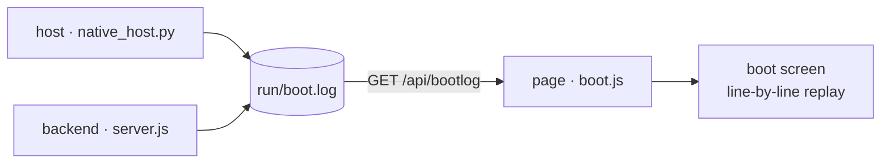

# Ponko-HUD

English version — [中文版 / Chinese version](README.md)

> A full-screen, borderless, eDEX-UI-style HUD desktop application for Windows. The interface is rendered frame by frame on a hand-drawn character grid, with no dependency on application frameworks such as Electron.

**Windows** · **Zero dependencies in the frontend / backend** · **code MIT / artwork all rights reserved** · UI languages `zh-cn` / `en` / `ja` / `ru` / `tlh`

## Table of Contents

- [Features](#features)
- [Dependencies](#dependencies)
- [Running](#running)
- [Boot self-check](#boot-self-check)
- [Structure](#structure)
- [Notes](#notes)
- [License](#license)

---

## Features

- **Hand-drawn character grid** — the entire interface is rendered glyph by glyph on Canvas 2D, rather than assembled from DOM elements
- **Boot self-check** — scrolls a screenful of kernel-style logs on startup, every line of which is a real event
  <details><summary>What each of the three log sources records (expand)</summary>

  the host (single-instance mutex / node path & version / backend pid & handshake timing / WebView2 load /
  window size), the backend (node & platform / whether an LLM is configured / asset-pack & frame counts /
  one real `python -V` probe / system & disk / saved conversations / listening port), and the page (canvas &
  font metrics / render engine / asset-pack load / restored conversations / real per-endpoint timings) — all
  real steps with real timings, timestamps shown verbatim; see the "Boot self-check" section.

  </details>
- **Real terminal** — a ConPTY-backed PTY with keys passed straight through (modelled on eDEX-UI / xterm.js); fully interactive programs such as vim / python / htop all run, Chinese IME included; multiple tabs, each an independent session
- **Agent chat** — connects to an OpenAI-compatible endpoint with streamed output. **Each conversation keeps its own LLM config** (pressing "+" pre-fills the form from the conversation you were looking at when you pressed it — empty if that one has no config; editing one never touches the others); the top-right corner of the panel shows **that conversation's** actual model id (never hardcoded); with nothing attached it reads `local · no LLM`. In the input box **Enter inserts a newline and `Ctrl+Enter` sends** (either Ctrl works; `Alt+Enter` sends too — handy when an IME has claimed the right Ctrl)
  <details><summary>How conversations are archived and deleted (expand)</summary>

  Multiple tabs correspond to multiple conversations, auto-saved to `run/conversations/` and restored verbatim
  after a restart. Each tab's **colour is saved too** (as an index in its archive), so "the blue one is the
  one I was just asking in" still holds after a restart — the palette is not reshuffled just because the
  restore order is "most recently touched last" (fixed 2026-10-15). **Every tab that is open gets saved** — even one with no LLM configured and nothing said
  in it — so "open two unconfigured tabs, close, reopen" still gives you two: the tab count never quietly
  shrinks (an empty conversation is stored with an empty title, never a UI string). Typing `/del chat` +
  `Ctrl+Enter` in the input box first raises a confirmation line, and
  only Enter actually closes the current conversation (archive included). A conversation without an LLM gets
  an inline config dialog; pressing **+** opens it too, **pre-filled from the conversation you were looking
  at when you pressed it** (blank if that one has no config yet) — edits there affect only that conversation. So switching model or gateway means opening a new
  conversation, not rewriting a global setting. The form belongs to the **conversation**: tab away half-way
  through and come back — it is exactly as you left it; only pressing Cancel undoes a brand-new conversation
  (tab included). A conversation counts as configured only **after you save**.

  </details>
- **Character** — the "character" row of the config form decides which character pack the right-hand panel draws:
  **auto** or any saved pack (`characters/<id>`). **The character is per conversation too** — switch tabs and the
  character switches with it. With **auto**, the model you just configured is handed the candidate list and picks
  one itself (it answers with an id; if it will not, the failure is reported and the default pack is used —
  **the config is still saved**). The pick is recorded in the conversation (`character: <id> (picked by <model>)`)
  and sticks across restarts
- **Personality** — the "personality" row of the same form (natural / tsundere / peppy / sarcastic / gentle),
  also **per conversation** and saved with it. It is the **persona handed to the model** and shapes how it
  expresses emotion: "natural" adds nothing extra (the prompt already writes it as a character with moods),
  the other four each bring their own tone and reactions
- **Live geography globe** — positioned from real IP / DNS data, a character-dot sphere projection with an auto marquee
- **Mood character** — the artwork is either a **dot-matrix image** (`src/*.png`, drawn straight onto the
  canvas, bypassing the character grid, then re-sampled into square dots) or a **block-character animation**
  (`frames/*.json`, the fallback when a pack has no hi-res art); the pack decides which one is used. The
  panel shows the character name in its top-left corner, and when the character changes the **old portrait stays
  on screen** until the new one is fully ready (no blank flash). Mood is driven autonomously by
  `[[mood:STATE|face:...]]` markers in the agent's replies (the marker itself is never displayed).
  **Emotions have memory and momentum**: every request hands the model "how you feel right now" (what you felt
  a moment ago, the line you were thinking, how long it has lasted), so it carries the mood forward instead of
  re-deriving it each turn — upset one turn does not become indifferent the next; it only settles once soothed.
  **Mood is per conversation** (2026-10-17): a new conversation starts idle and does not inherit the previous
  one's temper, tabs never bleed into each other — a background conversation's output cannot recolour the
  foreground, and each conversation's model only receives *its own* "how you feel right now".
  **Reopening looks exactly like it did when you quit**: the current mood (colour value, portrait face, the
  agent's own line, and its source) travels with the conversation file (`run/conversations/<id>.json`, `mood`
  field) and is restored per conversation on the next launch — so it is still there even after a while away
  (fixed 2026-10-15). **No state is folded on restore**, including `'working'` (formerly `stream`; what the
  prompt emits for "hands busy and fired up"): whatever it was when you quit is exactly what you get on reopen
  (fixed 2026-10-18). The seven states are `idle / think / working / happy / sleepy / angry / error`:
  `working` means "streaming tokens out / heads-down and going at it", `happy` means "mood has lit up"
  (praised, amused, something worked) — both can be true at once, and the model picks the one closer to the
  thought it is having (split apart on 2026-10-18 when `happy` was added).
  **Only the agent changes the mood** (2026-10-17): there is no "two quiet minutes → doze off" fallback, and a
  declared mood does not expire back to idle on its own — it stays until the agent speaks again. The program only
  touches it in three cases: a new conversation starts idle, a launch restores the mood the agent itself declared,
  and the `?mood=` debug bypass.
  **A turn that forgot the tag gets asked again** (2026-10-18): the model sometimes says "let's settle on this
  state" in prose while writing no tag at all — that turn then changes nothing on screen, which the user reads as
  "the mood was set wrong". So when a stream ends with zero declarations, the backend asks once more, showing the
  model its own just-written text and requesting a single tag line (still the model's judgement, never a local
  guess); if that fails, nothing is forced. What was actually declared each turn — and whether it came from the
  stream or from that follow-up — is logged to `run/mood.log`
- **Native window** — pywebview + WebView2, own taskbar identity, own icon, single instance
- **Dependency-free backend** — implemented purely on the Node standard library, with no third-party packages

---

## Dependencies

- **Frontend (`app/`)** — no build step, no npm packages, no CDN requests; browser-native APIs only.
- **Backend (`server/`)** — the Node standard library only.
- **Python host layer** — requires the following two third-party packages, both declared in `requirements.txt`:
  - `pywebview` — the native window shell (WebView2);
  - `pywinpty` — the ConPTY interactive-terminal bridge.
- **Development scripts (`tools/`)** — `Pillow` is needed to generate assets; the application itself does not require it.

Install the runtime dependencies:

```bat
pip install -r requirements.txt
```

---

## Running

```bat
start-native.bat        :: native window (recommended)
```

The backend listens on `127.0.0.1:8787` and is launched automatically by the start script.

The boot order follows "**window first, features come online progressively**": the host creates the window
first (containing a placeholder page), then pulls up the backend in the background — only once it genuinely
answers 200 does the window navigate to the real page. Probing the port (Winsock's first initialisation costs
365ms here), spawning node and waiting for the self-check no longer block window creation. Measured locally,
"double-click → window appears" dropped from **2.7s to 1.5s** (every boot writes that number to the "window
shown" line of `run/boot.log`). For further speed while debugging: `python native_host.py --fast` (skips the
boot scroll, saving ~2 more seconds).

Quitting: click the `✕ Quit` button at the top-right, or press `Ctrl+Shift+Q` (both require **two clicks /
presses** to confirm, preventing accidental exits). `stop.bat` still works from the command line.

---

## Boot self-check

eDEX-UI scrolls a screenful of kernel logs on boot; this project does the same, except it carries only
**real logs** — not one line was written merely to "look like a boot screen". Each of the three parts records
a line at the moment it actually happens, with a real timestamp:



| Source | Written by | What it records |
| --- | --- | --- |
| `host` | `native_host.py` | single-instance mutex, real `node.exe` path and `node -v`, backend pid & port, taskbar identity, pywebview version, window size, **how long the window took to show**, real port-handshake timing |
| `node` / `llm` / `pack` / `pty` / `conv` / `sys` / `net` | `server/server.js` | Node & platform versions, whether any conversation has an LLM attached — found by **scanning the conversation archives** (only host / model / protocol are reported, **the key is never echoed**), asset-pack / face / frame counts and sizes scanned live, the interpreter found by actually running `python -V`, system & disk state, saved conversation count, listening port, geolocation result |
| `ui` | the page itself | canvas pixels & dpr, cell size measured off the monospace font, real render engine (UA), asset-pack load, restored conversations, real per-endpoint round trips, full redraw timing of frame 3 |

The host and the backend append to **the same file** `run/boot.log` (the host truncates it at every boot,
so it holds only the current run); the frontend fetches it via `GET /api/bootlog` and replays it line by line
on the boot screen. The only piece of theatre is that the **gaps** between lines are squeezed into ~1.5s
(otherwise the whole screenful would flash past) — **the timestamp on each line is real and left untouched**.

After the last line it pauses ~0.3s so the final screen can be read, then **everything fades out together**
(all elements share one visibility value and dissolve into the theme background over ~0.34s, not a
line-by-line exit). Only once the fade finishes does the HUD's unfold animation begin.

- Raw records: `run/boot.log`. That directory is git-ignored and is never pushed to GitHub.
- The file stores **event ids + parameters**, not finished sentences:
  `2026-10-13 00:40:12.345  host   boot.host.started {"pid":1234,"py":"3.14.4"}`
  The text is rendered by the page in the **current language** (see "Language" below). This way neither the
  host nor the backend needs to know any language, yet every line of the boot screen can follow the language
  pack — those lines hit disk before the page ever obtains a language pack.
- Debugging: `?boot=0` skips the boot screen, `?bootpace=N` adjusts the replay budget (milliseconds),
  `?lang=en` switches language temporarily, `?art=photo` puts the portrait back to a plain blit
  (dot-matrix is the default).
- **Language**: UI strings (`ui.*`) and the boot screen (including the host / backend lines and the bottom
  progress bar) both follow the **language pack** — whatever the pack provides is used, and anything missing
  falls back to English (`en.js` is the shared fallback for `ui.*` and `boot.*` alike; missing entries fall to
  English rather than Chinese, so the screen is never half-and-half). `zh-cn.js` covers both sections in full,
  so under Simplified Chinese the whole UI and boot screen are Chinese; add the same keys to another pack and
  it gets the same treatment. **`ja.js` fills in `ui.*` only** (`boot.*` deliberately left empty) → under
  Japanese the UI is Japanese while the boot screen is English. **`ru.js` covers both sections in full**
  (including the dozens of host / backend lines) → under Russian both the UI and the boot screen are Russian.
  **`tlh.js` (Klingon) is complete too, and its text is written in the Klingon script (pIqaD, Private Use
  Area from U+F8D0) rather than romanised Klingon** — no system font on Windows covers that range, so the
  font ships with the app (`app/assets/fonts/pIqaD-qolqoS.ttf`, SIL OFL, unmodified) and is wired to the
  canvas through the `@font-face` in `style.css` and the font stack in `grid.js`. Convert back and forth with
  `node tools/piqad.mjs --roman/--piqad` instead of typing PUA code points by hand.
- Regression: `node tools/test_boot.mjs` (every backend line recomputes against the live machine), `node tools/test_boot_ui.mjs` (layout, typing and closing fade, the language pack deciding the sentence), `node tools/test_i18n.mjs` (language boundaries: only `ui.*` / `boot.*` may enter the dictionary, the service and recognition layers must never import i18n, every event id the host / backend emits must exist in both packs, and `ui.*` must be *complete* in `zh-cn` and `ja` — miss one and that entry falls through to `en.js`, leaving a stray English word on screen), `node tools/test_readme.mjs` (the two READMEs must stay structurally identical), `python tools/test_boot_host.py` (lines the host writes parse back verbatim).
- **When a behaviour changes, the language-pack strings describing it must be cleaned up too**: switching language has taken effect immediately since round 13, yet the reply still read "applies on next launch" — round 15 added a guard so that stale wording cannot return.

---

## Structure

```
app/src/        frontend: grid character grid, dots portrait dot-matrix, vt terminal emulation, panels, boot.js self-check screen
app/src/i18n/   language packs: index.js t() entry + zh-cn.js (Simplified Chinese, complete for ui.* and boot.*) + en.js (fallback for both: every entry missing from any pack lands here) + ja.js (Japanese UI; boot.* deliberately empty → falls to English) + ru.js (Russian, complete for ui.* and boot.*) + tlh.js (Klingon, complete for both, body text in pIqaD)
  + assets/fonts/pIqaD-qolqoS.ttf (Klingon script font, SIL OFL, redistributed unmodified)
server/         backend: server.js HTTP service, bootlog.js boot records, pty.js PTY management, ptybridge.py Windows ConPTY bridge
characters/     character assets (src/*.png artwork + frames/*.ans|json block frames); artwork is all rights reserved, not MIT (characters/LICENSE)
tools/assets/   application icons (.ico + sized png); artwork too, all rights reserved (tools/assets/LICENSE)
native_host.py  pywebview native window host
run/            runtime artefacts (saved conversations, ui-state.json UI state, boot.log, host.log): git-ignored, **never committed**
```

Tab hotkeys are only `Ctrl+Shift+T` (new) and `Ctrl+Tab` / `Ctrl+Shift+Tab` (cycle), dispatched by
**focus**: while SHELL has focus they drive terminal tabs, while AGENT has focus they drive conversation
tabs. **Closing a tab / deleting a conversation takes no hotkey** (`Ctrl+Shift+W` is removed): close a
terminal tab by typing `exit` inside it, delete a conversation by typing `/del chat` in the input box —
naming *which one* to close beats memorising a hotkey that fires on a slip of the hand.

To avoid memorising hotkeys, type a **slash command** into the conversation input box and send it with
`Ctrl+Enter`:

| Command | Effect |
|---|---|
| `/del chat` | requests closing the current conversation; a confirmation line is raised first, and **only Enter actually deletes** (including the `run/conversations/<id>.json` archive — there is no recycle bin) |

- The input expresses "which one I want gone", not "delete right now": once the command matches, only the red
  bar along the bottom is raised — `Enter` confirms / `ESC` cancels / typing anything else also counts as
  cancelling / ignoring it for 6 seconds lets it expire. What is deleted is the on-disk archive; this step
  costs time, not judgement — and it is the only way to delete a conversation (no hotkey exists).
- Only "the whole input is exactly `/del chat`" is recognised; anything with more content (such as
  `/del chat plz`) or an unrecognised command (`/foo`) is handed to the model as ordinary prose — user input
  is never swallowed, and the command itself never enters the conversation context.
- When only one conversation remains it cannot be closed (the panel has no "zero conversations" state) → it is
  **replaced by a fresh empty conversation** instead, with the old content and archive cleared together; the
  confirmation bar states this.
- With no LLM attached the panel is covered by the config form and the keyboard sits in its fields — typing the
  same command **in a field** works there too (otherwise the very state in which stale conversations most need
  clearing would be the one state that cannot clear them).

The SHELL panel has its own set of **built-in commands** (typed directly into the terminal, without a slash):

| Command | Effect |
|---|---|
| `lang` | shows the current `lang_id`, its usage and the switchable ids (one id per line) |
| `lang <lang_id>` | switches the UI language, **retranslating the whole screen on the spot** (the preference is also remembered in the browser, so the next launch keeps it) |
| `ponko-help` | panel help (the native `help` / `Get-Help` are left untouched) |
| `clear` / `cls` | clears the screen |
| `pty <cmd>` | opens a real terminal and runs any program |
| `exit` | ends this tab's session and closes the tab |

`lang` is built into the panel (real shells have no such command), so it takes precedence over a native command
of the same name; only "the whole line is exactly `lang` or `lang <one word>`" is recognised — `lang a b` is sent
to the shell as usual and input is never swallowed.

**Tab completion** (pipe mode): when the input box **has content**, `Tab` completes — paths against this tab's
**real working directory** (directories get a trailing `\`, so another `Tab` steps inside), and command names
(from executables on `PATH`) at the start of a line or after `|`. With several candidates it first extends to
their common prefix and lists the rest on screen; a letter or two more usually makes it unique. When the input
box is **empty**, `Tab` keeps its old job (switching focus between SHELL and AGENT). In the real terminal `Tab`
is passed straight through: `pty pwsh` / `pty python` completion is done by that program itself (it has far
more authority than this panel does), and this project stays out of it.

---

## Notes

**The bottom hint line reports only events that cannot be seen directly in the UI.** Deleting a conversation,
zooming / restoring a panel, switching tabs — the interface already reflects these (one fewer entry in the tab
bar, the panel filling the content area, the colour marks shifting), so no extra text is printed. Only three
kinds are kept:

- **Pressed, but nothing happened**: "the last conversation cannot be closed", "tab limit reached" — the reason for no effect needs stating;
- **Actions completed off-screen**: "copied N characters", "copy failed" — otherwise the result cannot be confirmed;
- **Actions needing one more confirmation**: "click Exit once more to confirm", "quitting…".

UI strings and code comments are in Chinese; the language-pack mechanism lives in `app/src/i18n/` (five packs
today: Simplified Chinese, English, Japanese, Russian, Klingon). Both `ui.*` (interface) and `boot.*` (boot log) are wired to the
packs: **whichever entry a pack is missing falls back to `en.js`** (English, not Chinese, so the screen is never
half-and-half). `ja.js` translates the **UI strings** and leaves `boot.*` deliberately empty — so under Japanese
the UI is Japanese while the boot screen is English; `ru.js` covers both sections, so under Russian both are
Russian; `tlh.js` is complete as well but its text is the **Klingon script** (pIqaD) rather than a Latin
transliteration, with the font shipped in `app/assets/fonts/` (SIL OFL). Switch language by typing `lang` in SHELL; the switchable
ids are listed on the spot; `lang <id>` **retranslates the whole screen on the spot** (including lines that
already scrolled past, the bottom hint, the config dialog — **no need to reopen the HUD**), and the preference
is remembered in the browser (the next launch keeps it). Machine paths are hardcoded — after cloning, adjust
the directories in `native_host.py` and `app/src/main.js` to your own setup.

---

## License

[Code: MIT](LICENSE) © 2026 visitor257

The **source code** (`app/`, `server/`, the scripts in `tools/`, `native_host.py`, …) is MIT-licensed.

**Artwork is not covered — all rights reserved**: `characters/` (portraits `src/*.png`, block frames
`frames/*`, `pack.json`) under [characters/LICENSE](characters/LICENSE), and `tools/assets/`
(application icons) under [tools/assets/LICENSE](tools/assets/LICENSE). Both carry the same terms:

- **You may**: run the project, build it from source for your own use, keep the artwork inside a
  fork or clone (that means publishing the fork's source, not shipping builds), show screenshots or
  recordings, and quote it unmodified with credit in non-commercial writing that introduces,
  reviews or references Ponko HUD.
- **You may not**: distribute any build, package, installer or store submission that contains the
  artwork — an APK, AAB, zip or any other installable form of this project or of a fork, free or
  paid, whether or not the source is published alongside it; use it commercially; modify, recolor,
  redraw or build derivative work from it (avatars, banners, covers or thumbnails, merchandise,
  other characters); extract it and redistribute it on its own (the non-commercial quoting above is
  the only exception).

For commercial use or anything else, open an issue first. The bundled Klingon font under
`app/assets/fonts/` is distributed under the SIL OFL, with its license text alongside.

"Ponko" is the name of this project; all rights in the name and in the artwork are reserved by the
author. Neither may be used in a way that suggests the author endorsed or authorised your product.

`characters/ponko/` holds the **shipping character artwork**: `src/` has 7 images — one per state.
⚠ The asset **tags** (file names) do not exactly match the state names: the `working` image is called
`streaming` (renaming a tag means renaming `frames/*.ans|*.json` too, and old saves carrying
`face:"streaming"` would stop matching — so the name stayed), the other six match.
`frames/` holds the block-character frames produced by `tools/charpack.py` (all seven share one framing,
so switching expressions does not make the character jump).
`happy` started as an extra face under `working` and became a state of its own on 2026-10-18: it needed
more than a different picture — its own colours and its own place on the mood bar (see "seven states" above).
`angry` and `error` are a pair of opposite bad moods — the former is fire aimed **outward**
(worked up, defiant), the latter is **inward** deflation (hurt, defeated); their themes are kept apart on
purpose (hot orange-red vs a cooler pinkish red) so you can tell at a glance which one it is.

The portrait has **two paths**, picked automatically per pack (the UI no longer labels which one is active):

- **Dot-matrix blit**: if `src/<tag>.png` exists it is first rasterised to the panel
  size with a contain fit, then **re-sampled into square dots** (`app/src/dots.js`) and painted straight
  onto the panel, **bypassing the character grid**. Sampling takes a 2x2-pixel block at a time; the dot's
  side follows that block's coverage (solid blocks fill the cell, silhouette blocks shrink to a small
  square — a halftone edge), and its colour is the block's alpha-weighted average. Sampling and painting
  happen once and are cached into an offscreen canvas, so each frame only blits a ready bitmap — the same
  cost as drawing the image directly. The same slot is only 28x19 = 532 solid colour blocks as characters,
  but 231x342 real pixels as an image. Launch with `?art=photo` for a **plain blit**.
- **Block characters**: falls back to `frames/*.json` when the pack has no `src/`
  image, or when the image fails to load.

**Mood names belong to the character pack** (2026-10-17). What a mood is called on screen lives in
that pack's own `frames/pack.json`, **not in the language files** — the name is part of the character
and ships with its artwork, so a different pack simply names things its own way without touching
any language file.

```json
"moods": {
  "idle": { "frames": ["idle.ans"], "fps": 0, "loop": false,
            "label": { "en": "idle", "zh-cn": "待机", "ja": "待機" } }
}
```

- **`en` is required**; other languages are optional. If the language in use is missing, English is
  shown; if even English is missing, the tag itself is shown (better to surface the id than to
  substitute another language).
- The mood name at the top of the panel and the "now …" line on the boot screen both use it.
  `tools/charpack.py --emit-pack` seeds a new pack with `{"en": <tag>}`; add other languages by hand.
- The bundled `ponko` pack **deliberately omits `ja`** (user, 2026-10-17: "Japanese needs no
  translation, I want to use Japanese to test the default display") — so choosing 日本語 shows the
  English mood names, which doubles as a live test of the fallback. Add a `label` entry to get
  Japanese names; no code change needed.
- `i18n` deliberately contains **no** `ui.mood.<state>` / `ui.theme.<state>` entries — don't add them
  back. Having both would create two sources of truth (switch packs without switching language and
  nobody can say which one should win).

**Manual override is a debug feature and both of its on-screen traces are hidden by default**
(`app/src/panels/char.js`): the row of clickable mood tags is not drawn (`SHOW_MOOD_CHIPS = false`),
and the "manual override (debug)" line under the portrait is not written either (`MUTE_NOTES`).
Flip those two switches during development to get them back. The capability is untouched:
`?mood=think` and `Ctrl+M` still switch moods, and the status line still says "manual".

**The old portrait never retreats early when the character changes (switching conversations).** The panel
keeps a snapshot of what is on screen right now and only swaps it once the new persona is **fully ready**
(image decoded *and* dots sampled) — so you never see "old portrait vanishes → blank while loading → new
portrait appears". While waiting, the incoming image and its dot canvas are prepared off-frame
(`preloadArt()` fans out every portrait in the pack, `grid.warmImg()` samples ahead); the swapping frame
itself is just one `drawImage`.

> Only the second path existed at first. Downscaling a painted illustration to 28 columns is bound to
> blur, so `tools/make_ponko_geo.py` was written to draw a flat-shape figure instead. That proved the
> blur came from the **character grid's resolution floor**, not from the drawing style — so the fix was
> to take the portrait off the grid. The geometric version is kept in `characters/_archive/ponko-geo/`
> and is no longer loaded.

`characters/ponko/src` is produced from the original character art by `tools/_matte_pack.py`
(connected-component background removal + watermark cleanup + waist crop); no third-party assets.
The license does **not** follow the code: the code is MIT, the artwork is all rights reserved
([characters/LICENSE](characters/LICENSE)).

`characters/_archive/` only keeps historical looks that are **no longer loaded** (the geometric
`ponko-geo`, the earlier `ponko-ai`) — the scan runs one level under `characters/` and never walks in.
The placeholder character used during development (`ds-whale`) is gone; to exercise the asset pipeline
again, run `tools/make_test_assets.py`, which draws the five test portraits into the system temp
directory and leaves nothing in the repo.

(Every pack with a `frames/pack.json` under `characters/` is a candidate in the character list, picked
per conversation.)
