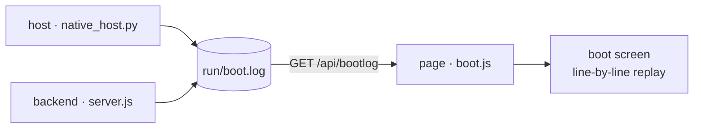

# Ponko-HUD

English version — [中文版 / Chinese version](README.md)

> A full-screen, borderless eDEX-UI-style HUD desktop app for Windows. It draws its own character grid — none of Electron's heavy shell.

**Windows** · **Zero third-party dependencies** · **MIT** · UI languages `zh-cn` / `en` / `ja`

## Table of Contents

- [Features](#features)
- [Running](#running)
- [Boot self-check](#boot-self-check)
- [Structure](#structure)
- [Notes](#notes)
- [License](#license)

---

## Features

- **Hand-drawn character grid** — the whole UI is rendered glyph by glyph on Canvas 2D, not assembled from DOM nodes
- **Boot self-check scroll** — it scrolls a screenful of kernel logs on startup, but **every line is real**
  <details><summary>What each of the three sources records (expand)</summary>

  the host (single-instance mutex / node path & version / backend pid & handshake timing / WebView2 load /
  window size), the backend (node & platform / is an LLM configured / asset-pack & frame counts / one real
  `python -V` probe / system & disk / saved conversations / listening port), and the page (canvas & font
  metrics / render engine / asset-pack load / restored conversations / real per-endpoint timings) — each with
  its real steps and real timings, timestamps shown verbatim. See "Boot self-check".

  </details>
- **Real terminal** — ConPTY-backed PTY, keys passed straight through (modelled on eDEX-UI / xterm.js); fully interactive programs like vim / python / htop all run, Chinese IME included; tabbed terminals, each tab an independent session
- **Agent chat** — OpenAI-compatible endpoint, streamed output. **The top-right corner of the panel shows the model id actually connected right now** (read back from backend config, never hardcoded); with nothing attached it reads `local · no LLM`
  <details><summary>How conversations are saved and deleted (expand)</summary>

  Multiple tabs = multiple conversations, auto-saved to `run/conversations/` and restored after a restart;
  type `/del chat` + `Ctrl+Enter` in the input box for a confirmation line — Enter actually closes the current
  conversation (archive included, see below). A config dialog appears inline when no LLM is configured.

  </details>
- **Live geography globe** — real IP / DNS geolocation, character-dot sphere projection with an auto marquee
- **Mood character** — a block-character animated avatar whose mood is driven by the agent itself through `[[mood:STATE|face:...]]` markers in its replies
- **Native window** — pywebview + WebView2, own taskbar identity, own icon, single instance
- **Dependency-free backend** — plain Node standard library, no third-party packages

---

## Running

```bat
start-native.bat        :: native window (recommended)
```

The backend listens on `127.0.0.1:8787`, launched automatically by the start script.

The boot order is "**window first, features come online gradually**": the host builds the window first
(with a placeholder page inside), then pulls up the backend in the background — only once it really
answers 200 does the window navigate to the real page. Probing the port (Winsock's first init costs
365ms here), spawning node, waiting for its self-check: none of that blocks window creation anymore.
Measured locally, "double-click → window appears" went **2.7s → 1.5s** (every boot writes that number
onto the "window shown" line of `run/boot.log`). Want it even faster while debugging:
`python native_host.py --fast` (skips the boot scroll, ~2 more seconds saved).

Quitting: click the `✕ Quit` button at the top-right, or press `Ctrl+Shift+Q` (both need **two clicks /
presses** to confirm, so you can't quit by accident). `stop.bat` still works from the command line.

---

## Boot self-check

eDEX-UI scrolls a screenful of kernel logs on boot; this does the same thing, except it only carries
**real logs** — not one line was written merely to "look like a boot screen". Each of the three sources
writes its own line at the moment it actually happens, with a real timestamp:



| Source | Written by | What it records |
| --- | --- | --- |
| `host` | `native_host.py` | single-instance mutex, real `node.exe` path and `node -v`, backend pid & port, taskbar identity, pywebview version, window size, **how long the window took to show**, real port-handshake timing |
| `node` / `llm` / `pack` / `pty` / `conv` / `sys` / `net` | `server/server.js` | Node & platform versions, whether an LLM is configured (**the key is never echoed**), asset-pack / face / frame counts and sizes scanned live, the interpreter found by actually running `python -V`, system & disk state, saved conversation count, listening port, geolocation result |
| `ui` | the page itself | canvas pixels & dpr, cell size measured off the monospace font, real render engine (UA), asset-pack load, restored conversations, real per-endpoint round trips, full redraw timing of frame 3 |

The host and the backend append to **the same file** `run/boot.log` (the host truncates it at every boot,
so it only holds the current run); the frontend fetches it via `GET /api/bootlog` and replays it line by
line on the boot screen. The only piece of theatre is that the **gaps** between lines are squeezed into
~1.5s (otherwise the whole screenful flashes past in an instant) — **the timestamp on each line is real
and untouched**.

After the last line it pauses ~0.3s so you can read the final screen, then **everything fades out
together** (all elements share one visibility value and dissolve into the theme background over ~0.34s,
not a line-by-line exit). Only once the fade finishes does the HUD's unfold animation begin.

- Raw records are right there in `run/boot.log`. That directory is git-ignored, never pushed to GitHub.
- The file holds **event ids + parameters**, not finished sentences:
  `2026-10-13 00:40:12.345  host   boot.host.started {"pid":1234,"py":"3.14.4"}`
  The sentence itself is rendered by the page in the **current language** (see "Language" below). That way
  neither the host nor the backend needs to know any language, yet every line of the boot screen follows
  the language pack — those lines hit disk before the page ever gets a language pack.
- Debugging: `?boot=0` skips the boot screen, `?bootpace=N` changes the replay budget (milliseconds),
  `?lang=en` switches language temporarily.
- **Language**: UI strings (`ui.*`) and the boot screen (including the host/backend lines and the bottom
  progress bar) both follow the **language pack** — whatever the pack provides is used, anything missing
  falls back to English (`en.js` is the shared fallback for `ui.*` and `boot.*` alike; missing entries land
  in English rather than Chinese, so you never get a half-English half-Chinese screen). `zh-cn.js` covers
  both sections completely, so under Simplified Chinese everything is Chinese; add the same keys to another
  pack and it gets the same treatment. **`ja.js` only fills in `ui.*`** (`boot.*` deliberately left empty)
  → under Japanese the UI is Japanese while the boot screen is English.
- Regression: `node tools/test_boot.mjs` (every backend line recomputes against the live machine),
  `node tools/test_boot_ui.mjs` (layout, typing, closing fade, the language pack decides the sentence),
  `node tools/test_i18n.mjs` (language boundaries: only `ui.*`/`boot.*` may enter the dictionary, the service
  and recognition layers must never import i18n, every event id the host/backend emits must exist in both
  packs, and `ui.*` has to be *complete* in `zh-cn` and `ja` — miss one and that entry falls through to
  `en.js`, leaving a stray English word on screen), `node tools/test_readme.mjs` (the two READMEs must stay
  structurally identical), `python tools/test_boot_host.py` (lines the host writes parse back verbatim).
- **When a behaviour changes, clean up the language-pack strings that describe it too**: switching language
  has taken effect immediately since round 13, yet the reply still read "applies on next launch" — round 15
  added a guard so that stale wording cannot come back.

---

## Structure

```
app/src/        frontend: grid character grid, vt terminal emulation, panels, boot.js self-check screen
app/src/i18n/   language packs: index.js t() entry + zh-cn.js (Simplified Chinese, complete for ui.* and boot.*) + en.js (fallback for both: every entry missing from any pack lands here) + ja.js (Japanese UI; boot.* deliberately empty → falls to English)
server/         backend: server.js HTTP service, bootlog.js boot records, pty.js PTY management, ptybridge.py Windows ConPTY bridge
characters/     character animation assets (.ans / .json)
native_host.py  pywebview native window host
run/            runtime artefacts (saved conversations, boot.log, host.log): git-ignored, **never committed**
```

Tab hotkeys are only `Ctrl+Shift+T` (new) and `Ctrl+Tab` / `Ctrl+Shift+Tab` (cycle), dispatched by
**focus**: while SHELL has focus they drive terminal tabs, while AGENT has focus they drive conversation
tabs. **Closing a tab / deleting a conversation gets no hotkey** (`Ctrl+Shift+W` is gone): close a terminal
tab by typing `exit` inside it, delete a conversation by typing `/del chat` in the input box — one sentence
says *which one* to close, which beats memorising a hotkey that fires on a slip of the hand.

Rather not remember hotkeys at all? Type a **slash command** into the conversation input box and send it
with `Ctrl+Enter`:

| Command | Effect |
|---|---|
| `/del chat` | asks to close the current conversation; a confirmation line appears first, **Enter actually deletes** (including the `run/conversations/<id>.json` archive — there is no recycle bin) |

- Typing expresses "which one I want gone", not "delete right now": once the command matches, only the red
  bar along the bottom appears — `Enter` confirms / `ESC` cancels / starting to type anything else counts as
  cancelling / ignoring it for 6 seconds lets it expire. What gets deleted is the archive on disk; that extra
  step costs time, not judgement — and it is the only way to delete a conversation (no hotkey exists).
- Only "the whole input is exactly `/del chat`" counts; anything else (`/del chat plz`) or an unrecognised
  command (`/foo`) is handed to the model as ordinary prose — your words are never swallowed, and the command
  itself never enters the conversation context.
- With a single conversation left it cannot be closed (the panel has no "zero conversations" state) → it is
  **replaced by a fresh empty conversation** instead, old content and archive cleared together; the
  confirmation bar states that explicitly.
- With no LLM attached the panel is covered by the config form and the keyboard sits in its fields — typing the
  same command **in a field** works there too (otherwise the one state where you most want to clear stale
  conversations would be the one state you can't).

The SHELL panel has its own set of **built-in commands** (typed straight into the terminal, no slash):

| Command | Effect |
|---|---|
| `lang` | shows the current `lang_id`, its usage, and the switchable ids (one id per line) |
| `lang <lang_id>` | switches the UI language, **retranslating the whole screen on the spot** (the preference is remembered in the browser too, so the next launch keeps it) |
| `ponko-help` | panel help (the native `help` / `Get-Help` stay untouched) |
| `clear` / `cls` | clears the screen |
| `pty <cmd>` | opens a real terminal and runs any program |
| `exit` | ends this tab's session and closes the tab |

`lang` is built into the panel (real shells have no such command), so it takes precedence over a native
command of the same name; it only matches "the whole line is exactly `lang` or `lang <one word>`" —
`lang a b` is handed to the shell as usual, nothing you typed gets eaten.

---

## Notes

**The bottom hint line only reports things you cannot see.** Deleted a conversation, zoomed/restored a panel,
switched tabs — the UI already says all of that itself (one fewer entry in the tab bar, the box filling the
content area, the colour marks shifting), so nothing extra gets printed. Only three kinds of invisible
-but-worth-reporting are kept:

- **You pressed and nothing happened**: "the last conversation cannot be closed", "tab limit reached" — you are
  owed the reason why nothing moved;
- **Results of actions happening off-screen**: "copied N characters", "copy failed" — otherwise you'd never know;
- **Things that need one more move from you**: "click Exit once more to confirm", "quitting…".

UI strings and code comments are Chinese; the language-pack mechanism lives in `app/src/i18n/` (three packs
today: Simplified Chinese, English, Japanese). Both `ui.*` (interface) and `boot.*` (boot log) are wired to
the packs: **whichever entry a pack is missing falls through to `en.js`** (English, not Chinese — you never
get a half-and-half screen). `ja.js` translates the **UI strings** and leaves `boot.*` deliberately empty —
so under Japanese the UI is Japanese while the boot screen is English. Switch language by typing `lang` in
SHELL; the switchable ids are listed on the spot; `lang <id>` **retranslates the whole screen on the spot**
(including lines that already scrolled past, the bottom hint, the config dialog — **no need to reopen the
HUD**), and the preference is remembered in the browser (the next launch keeps it).
Machine paths are hardcoded — after cloning, adjust the directories in `native_host.py` and
`app/src/main.js` to your own setup.

---

## License

[MIT](LICENSE) © 2026 visitor257

`characters/ds-whale/` is a **placeholder character used during development**, generated programmatically by
`tools/make_test_assets.py` (drawn from geometry, contains no third-party assets) and covered by the same MIT
license. It will be replaced by the final character artwork — don't depend on it.
