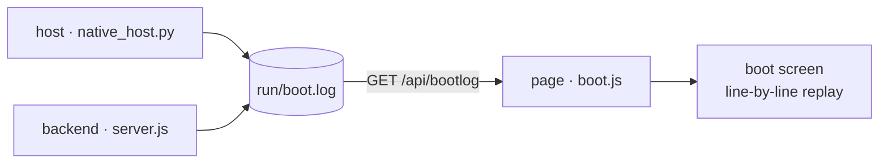

# Ponko-HUD

English version — [中文版 / Chinese version](README.md)

> A full-screen, borderless, eDEX-UI-style HUD desktop application for Windows. The interface is rendered frame by frame on a hand-drawn character grid, with no dependency on application frameworks such as Electron.

**Windows** · **Zero dependencies in the frontend / backend** · **MIT** · UI languages `zh-cn` / `en` / `ja`

## Table of Contents

- [Features](#features)
- [Dependencies](#dependencies)
- [Running](#running)
- [Boot self-check](#boot-self-check)
- [Structure](#structure)
- [Notes](#notes)
- [License](#license)

---

## Features

- **Hand-drawn character grid** — the entire interface is rendered glyph by glyph on Canvas 2D, rather than assembled from DOM elements
- **Boot self-check** — scrolls a screenful of kernel-style logs on startup, every line of which is a real event
  <details><summary>What each of the three log sources records (expand)</summary>

  the host (single-instance mutex / node path & version / backend pid & handshake timing / WebView2 load /
  window size), the backend (node & platform / whether an LLM is configured / asset-pack & frame counts /
  one real `python -V` probe / system & disk / saved conversations / listening port), and the page (canvas &
  font metrics / render engine / asset-pack load / restored conversations / real per-endpoint timings) — all
  real steps with real timings, timestamps shown verbatim; see the "Boot self-check" section.

  </details>
- **Real terminal** — a ConPTY-backed PTY with keys passed straight through (modelled on eDEX-UI / xterm.js); fully interactive programs such as vim / python / htop all run, Chinese IME included; multiple tabs, each an independent session
- **Agent chat** — connects to an OpenAI-compatible endpoint with streamed output. **The top-right corner of the panel shows the model id actually connected right now** (read from the backend config, never hardcoded); with nothing attached it reads `local · no LLM`
  <details><summary>How conversations are archived and deleted (expand)</summary>

  Multiple tabs correspond to multiple conversations, auto-saved to `run/conversations/` and restored verbatim
  after a restart; typing `/del chat` + `Ctrl+Enter` in the input box first raises a confirmation line, and
  only Enter actually closes the current conversation (archive included). When no LLM is configured, a config
  dialog appears inline.

  </details>
- **Live geography globe** — positioned from real IP / DNS data, a character-dot sphere projection with an auto marquee
- **Mood character** — a block-character animated avatar whose mood is driven autonomously by `[[mood:STATE|face:...]]` markers in the agent's replies
- **Native window** — pywebview + WebView2, own taskbar identity, own icon, single instance
- **Dependency-free backend** — implemented purely on the Node standard library, with no third-party packages

---

## Dependencies

- **Frontend (`app/`)** — no build step, no npm packages, no CDN requests; browser-native APIs only.
- **Backend (`server/`)** — the Node standard library only.
- **Python host layer** — requires the following two third-party packages, both declared in `requirements.txt`:
  - `pywebview` — the native window shell (WebView2);
  - `pywinpty` — the ConPTY interactive-terminal bridge.
- **Development scripts (`tools/`)** — `Pillow` is needed to generate assets; the application itself does not require it.

Install the runtime dependencies:

```bat
pip install -r requirements.txt
```

---

## Running

```bat
start-native.bat        :: native window (recommended)
```

The backend listens on `127.0.0.1:8787` and is launched automatically by the start script.

The boot order follows "**window first, features come online progressively**": the host creates the window
first (containing a placeholder page), then pulls up the backend in the background — only once it genuinely
answers 200 does the window navigate to the real page. Probing the port (Winsock's first initialisation costs
365ms here), spawning node and waiting for the self-check no longer block window creation. Measured locally,
"double-click → window appears" dropped from **2.7s to 1.5s** (every boot writes that number to the "window
shown" line of `run/boot.log`). For further speed while debugging: `python native_host.py --fast` (skips the
boot scroll, saving ~2 more seconds).

Quitting: click the `✕ Quit` button at the top-right, or press `Ctrl+Shift+Q` (both require **two clicks /
presses** to confirm, preventing accidental exits). `stop.bat` still works from the command line.

---

## Boot self-check

eDEX-UI scrolls a screenful of kernel logs on boot; this project does the same, except it carries only
**real logs** — not one line was written merely to "look like a boot screen". Each of the three parts records
a line at the moment it actually happens, with a real timestamp:



| Source | Written by | What it records |
| --- | --- | --- |
| `host` | `native_host.py` | single-instance mutex, real `node.exe` path and `node -v`, backend pid & port, taskbar identity, pywebview version, window size, **how long the window took to show**, real port-handshake timing |
| `node` / `llm` / `pack` / `pty` / `conv` / `sys` / `net` | `server/server.js` | Node & platform versions, whether an LLM is configured (**the key is never echoed**), asset-pack / face / frame counts and sizes scanned live, the interpreter found by actually running `python -V`, system & disk state, saved conversation count, listening port, geolocation result |
| `ui` | the page itself | canvas pixels & dpr, cell size measured off the monospace font, real render engine (UA), asset-pack load, restored conversations, real per-endpoint round trips, full redraw timing of frame 3 |

The host and the backend append to **the same file** `run/boot.log` (the host truncates it at every boot,
so it holds only the current run); the frontend fetches it via `GET /api/bootlog` and replays it line by line
on the boot screen. The only piece of theatre is that the **gaps** between lines are squeezed into ~1.5s
(otherwise the whole screenful would flash past) — **the timestamp on each line is real and left untouched**.

After the last line it pauses ~0.3s so the final screen can be read, then **everything fades out together**
(all elements share one visibility value and dissolve into the theme background over ~0.34s, not a
line-by-line exit). Only once the fade finishes does the HUD's unfold animation begin.

- Raw records: `run/boot.log`. That directory is git-ignored and is never pushed to GitHub.
- The file stores **event ids + parameters**, not finished sentences:
  `2026-10-13 00:40:12.345  host   boot.host.started {"pid":1234,"py":"3.14.4"}`
  The text is rendered by the page in the **current language** (see "Language" below). This way neither the
  host nor the backend needs to know any language, yet every line of the boot screen can follow the language
  pack — those lines hit disk before the page ever obtains a language pack.
- Debugging: `?boot=0` skips the boot screen, `?bootpace=N` adjusts the replay budget (milliseconds),
  `?lang=en` switches language temporarily.
- **Language**: UI strings (`ui.*`) and the boot screen (including the host / backend lines and the bottom
  progress bar) both follow the **language pack** — whatever the pack provides is used, and anything missing
  falls back to English (`en.js` is the shared fallback for `ui.*` and `boot.*` alike; missing entries fall to
  English rather than Chinese, so the screen is never half-and-half). `zh-cn.js` covers both sections in full,
  so under Simplified Chinese the whole UI and boot screen are Chinese; add the same keys to another pack and
  it gets the same treatment. **`ja.js` fills in `ui.*` only** (`boot.*` deliberately left empty) → under
  Japanese the UI is Japanese while the boot screen is English.
- Regression: `node tools/test_boot.mjs` (every backend line recomputes against the live machine), `node tools/test_boot_ui.mjs` (layout, typing and closing fade, the language pack deciding the sentence), `node tools/test_i18n.mjs` (language boundaries: only `ui.*` / `boot.*` may enter the dictionary, the service and recognition layers must never import i18n, every event id the host / backend emits must exist in both packs, and `ui.*` must be *complete* in `zh-cn` and `ja` — miss one and that entry falls through to `en.js`, leaving a stray English word on screen), `node tools/test_readme.mjs` (the two READMEs must stay structurally identical), `python tools/test_boot_host.py` (lines the host writes parse back verbatim).
- **When a behaviour changes, the language-pack strings describing it must be cleaned up too**: switching language has taken effect immediately since round 13, yet the reply still read "applies on next launch" — round 15 added a guard so that stale wording cannot return.

---

## Structure

```
app/src/        frontend: grid character grid, vt terminal emulation, panels, boot.js self-check screen
app/src/i18n/   language packs: index.js t() entry + zh-cn.js (Simplified Chinese, complete for ui.* and boot.*) + en.js (fallback for both: every entry missing from any pack lands here) + ja.js (Japanese UI; boot.* deliberately empty → falls to English)
server/         backend: server.js HTTP service, bootlog.js boot records, pty.js PTY management, ptybridge.py Windows ConPTY bridge
characters/     character animation assets (.ans / .json)
native_host.py  pywebview native window host
run/            runtime artefacts (saved conversations, boot.log, host.log): git-ignored, **never committed**
```

Tab hotkeys are only `Ctrl+Shift+T` (new) and `Ctrl+Tab` / `Ctrl+Shift+Tab` (cycle), dispatched by
**focus**: while SHELL has focus they drive terminal tabs, while AGENT has focus they drive conversation
tabs. **Closing a tab / deleting a conversation takes no hotkey** (`Ctrl+Shift+W` is removed): close a
terminal tab by typing `exit` inside it, delete a conversation by typing `/del chat` in the input box —
naming *which one* to close beats memorising a hotkey that fires on a slip of the hand.

To avoid memorising hotkeys, type a **slash command** into the conversation input box and send it with
`Ctrl+Enter`:

| Command | Effect |
|---|---|
| `/del chat` | requests closing the current conversation; a confirmation line is raised first, and **only Enter actually deletes** (including the `run/conversations/<id>.json` archive — there is no recycle bin) |

- The input expresses "which one I want gone", not "delete right now": once the command matches, only the red
  bar along the bottom is raised — `Enter` confirms / `ESC` cancels / typing anything else also counts as
  cancelling / ignoring it for 6 seconds lets it expire. What is deleted is the on-disk archive; this step
  costs time, not judgement — and it is the only way to delete a conversation (no hotkey exists).
- Only "the whole input is exactly `/del chat`" is recognised; anything with more content (such as
  `/del chat plz`) or an unrecognised command (`/foo`) is handed to the model as ordinary prose — user input
  is never swallowed, and the command itself never enters the conversation context.
- When only one conversation remains it cannot be closed (the panel has no "zero conversations" state) → it is
  **replaced by a fresh empty conversation** instead, with the old content and archive cleared together; the
  confirmation bar states this.
- With no LLM attached the panel is covered by the config form and the keyboard sits in its fields — typing the
  same command **in a field** works there too (otherwise the very state in which stale conversations most need
  clearing would be the one state that cannot clear them).

The SHELL panel has its own set of **built-in commands** (typed directly into the terminal, without a slash):

| Command | Effect |
|---|---|
| `lang` | shows the current `lang_id`, its usage and the switchable ids (one id per line) |
| `lang <lang_id>` | switches the UI language, **retranslating the whole screen on the spot** (the preference is also remembered in the browser, so the next launch keeps it) |
| `ponko-help` | panel help (the native `help` / `Get-Help` are left untouched) |
| `clear` / `cls` | clears the screen |
| `pty <cmd>` | opens a real terminal and runs any program |
| `exit` | ends this tab's session and closes the tab |

`lang` is built into the panel (real shells have no such command), so it takes precedence over a native command
of the same name; only "the whole line is exactly `lang` or `lang <one word>`" is recognised — `lang a b` is sent
to the shell as usual and input is never swallowed.

---

## Notes

**The bottom hint line reports only events that cannot be seen directly in the UI.** Deleting a conversation,
zooming / restoring a panel, switching tabs — the interface already reflects these (one fewer entry in the tab
bar, the panel filling the content area, the colour marks shifting), so no extra text is printed. Only three
kinds are kept:

- **Pressed, but nothing happened**: "the last conversation cannot be closed", "tab limit reached" — the reason for no effect needs stating;
- **Actions completed off-screen**: "copied N characters", "copy failed" — otherwise the result cannot be confirmed;
- **Actions needing one more confirmation**: "click Exit once more to confirm", "quitting…".

UI strings and code comments are in Chinese; the language-pack mechanism lives in `app/src/i18n/` (three packs
today: Simplified Chinese, English, Japanese). Both `ui.*` (interface) and `boot.*` (boot log) are wired to the
packs: **whichever entry a pack is missing falls back to `en.js`** (English, not Chinese, so the screen is never
half-and-half). `ja.js` translates the **UI strings** and leaves `boot.*` deliberately empty — so under Japanese
the UI is Japanese while the boot screen is English. Switch language by typing `lang` in SHELL; the switchable
ids are listed on the spot; `lang <id>` **retranslates the whole screen on the spot** (including lines that
already scrolled past, the bottom hint, the config dialog — **no need to reopen the HUD**), and the preference
is remembered in the browser (the next launch keeps it). Machine paths are hardcoded — after cloning, adjust
the directories in `native_host.py` and `app/src/main.js` to your own setup.

---

## License

[MIT](LICENSE) © 2026 visitor257

`characters/ds-whale/` is a **placeholder character used during development**, generated programmatically by
`tools/make_test_assets.py` (drawn from geometry, containing no third-party assets) and covered by the same MIT
license. It will be replaced by the final character artwork — do not depend on it.
