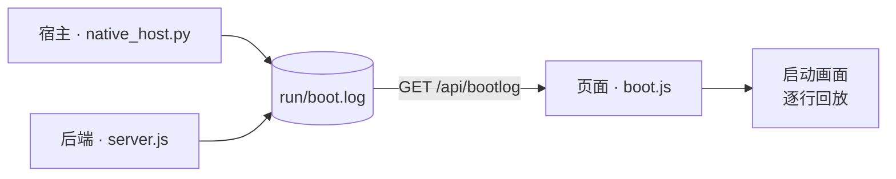

# Ponko-HUD

English version — [README.en.md](README.en.md)

> 全屏无边框的 eDEX-UI 风格 HUD 桌面应用（Windows）。界面由自绘字符网格逐帧渲染，不依赖 Electron 等应用框架。

**Windows** · **前端 / 后端零依赖** · **MIT** · 界面语言 `zh-cn` / `en` / `ja`

## 目录

- [特性](#特性)
- [依赖](#依赖)
- [运行](#运行)
- [启动自检（开机刷屏）](#启动自检开机刷屏)
- [结构](#结构)
- [说明](#说明)
- [License](#license)

---

## 特性

- **自绘字符网格** —— 整个界面由 Canvas 2D 逐字符渲染，而非 DOM 元素拼装
- **开机自检** —— 启动时逐行滚动内核式日志，每一行均为真实事件
  <details><summary>三段日志各自记录什么（展开）</summary>

  宿主（单实例互斥体 / node 路径与版本 / 后端进程与握手耗时 / WebView2 装载 / 窗口尺寸）、
  后端（node 与平台 / 是否已配置 LLM / 素材包与帧文件数 / 一次真实的 `python -V` 探测 /
  系统与磁盘 / 对话存档数 / 端口监听）、页面（画布与字体度量 / 渲染内核 / 素材包装载 /
  对话恢复 / 各接口真实耗时）—— 均为真实步骤与真实耗时，时间戳原样显示，详见「启动自检」一节。

  </details>
- **真实终端** —— 由 ConPTY 驱动的 PTY，按键直通（模型参照 eDEX-UI / xterm.js）；vim / python / htop 等全交互程序均可运行，中文 IME 正常；支持多标签，每个标签为独立会话
- **Agent 对话** —— 接入 OpenAI 兼容接口，流式输出。**框顶右上角显示当前实际连接的模型 id**（由后端配置读取，不写死），未接入时显示 `local · 未接 LLM`
  <details><summary>对话的存档与删除（展开）</summary>

  多标签对应多个对话，自动存档至 `run/conversations/`，重启后原样恢复；在输入框输入
  `/del chat` + `Ctrl+Enter` 会先弹出确认行，回车后才真正关闭当前对话（连同存档）。
  未配置 LLM 时，界面内直接弹出配置框。

  </details>
- **实时地理地球** —— 由真实 IP / DNS 定位，字符点阵球面投影，自动跑马灯
- **心情角色** —— 方块字符动画角色，心情由 Agent 正文中的 `[[mood:STATE|face:...]]` 标记自主控制
- **原生窗口** —— pywebview + WebView2，独立任务栏身份、自有图标、单实例
- **零依赖后端** —— 纯 Node 标准库实现，无任何第三方包

---

## 依赖

- **前端（`app/`）** —— 无构建步骤、无 npm 包、无 CDN 请求，仅使用浏览器原生 API。
- **后端（`server/`）** —— 仅依赖 Node 标准库。
- **Python 宿主层** —— 需要以下两个第三方包，均已在 `requirements.txt` 中声明：
  - `pywebview` —— 原生窗口外壳（WebView2）；
  - `pywinpty` —— ConPTY 交互式终端桥。
- **开发脚本（`tools/`）** —— 生成素材时需要 `Pillow`，运行应用本身不需要。

安装运行时依赖：

```bat
pip install -r requirements.txt
```

---

## 运行

```bat
start-native.bat        :: 原生窗口（推荐）
```

后端监听 `127.0.0.1:8787`，由启动脚本自动拉起。

启动顺序采用「**窗口先接入，功能逐步就绪**」：宿主先创建窗口（内为占位页），后端在后台拉起，
待其真正应答 200 后窗口才导航至真实页面 —— 端口探测（Winsock 首次初始化，实测 365ms）、
拉起 node、等待自检，均不再阻塞建窗。本机实测「双击 → 窗口出现」由 **2.7s 降至 1.5s**
（每次启动都会将该数字写入 `run/boot.log` 的「窗口已显示」行）。调试时可进一步加速：
`python native_host.py --fast`（跳过启动刷屏，再省约 2 秒）。

退出：点击界面右上角的 `✕ 退出` 按钮，或按 `Ctrl+Shift+Q`（两者均需**连点 / 连按两次**确认，防误触）。
命令行退出仍为 `stop.bat`。

---

## 启动自检（开机刷屏）

eDEX-UI 开机时会滚动一屏内核日志；本项目做的是同一件事，但只放**真实日志** —— 没有任何一行
是为了「像启动画面」而写死的。三部分各自在真正发生的那一刻记录一行，带真实时间戳：



| 来源 | 记录者 | 记录内容 |
| --- | --- | --- |
| `host` | `native_host.py` | 单实例互斥体、`node.exe` 真实路径与 `node -v`、后端 pid 与端口、任务栏身份、pywebview 版本、窗口尺寸、**窗口显示耗时**、端口握手真实耗时 |
| `node` / `llm` / `pack` / `pty` / `conv` / `sys` / `net` | `server/server.js` | Node 与平台版本、是否已配置 LLM（**绝不回显 Key**）、现场扫描得到的素材包 / 表情 / 帧文件数与体积、实际运行一次 `python -V` 探测到的解释器、系统与磁盘现状、对话存档数、监听端口、地理查询结果 |
| `ui` | 页面自身 | 画布像素与 dpr、等宽字体实测出的单元格、真实渲染内核（UA）、素材包装载、恢复的对话、各接口真实往返耗时、第 3 帧的整幅重绘耗时 |

宿主与后端将日志追加到**同一个文件** `run/boot.log`（每次启动由宿主截断，仅保留本次），
前端通过 `GET /api/bootlog` 取回，在启动画面上逐行回放。回放唯一的「演出成分」是将行与行之间的
**间隔**按比例压缩进约 1.5s（否则一屏文字会瞬间闪过）—— **每行显示的时间戳都是真实的，不做任何改动**。

放完后先停顿约 0.3s 以便看清最后一屏，再**整屏同步淡出**（所有元素共用同一可见度，一起溶入
主题背景，约 0.34s，非逐行退出），淡出结束后才进入 HUD 的展开动画。

- 原始记录：`run/boot.log`。该目录不入库，不会被推送到 GitHub。
- 文件中存储的是**事件 id + 参数**，而非成句文本：
  `2026-10-13 00:40:12.345  host   boot.host.started {"pid":1234,"py":"3.14.4"}`
  文本由页面按**当前语言**渲染（见下「语言」）。因此宿主与后端无需了解任何语言，而启动画面上的
  每一行都能跟随语言包 —— 这些行在页面取得语言包之前就已落盘。
- 调试：`?boot=0` 跳过启动画面，`?bootpace=N` 调整回放预算（毫秒），`?lang=en` 临时切换语言。
- **语言**：界面文案（`ui.*`）与启动画面（含宿主 / 后端各行、底部进度条）均跟随**语言包** ——
  语言包中有则使用该语言，没有则回退英文（`en.js` 是 `ui.*` 与 `boot.*` 共同的兜底；缺项回退
  英文而非中文，以免中英混杂）。简中包 `zh-cn.js` 两段均为全量，故简中下界面与启动画面均为中文；
  其他语言补上同名 key 即可获得同样效果。**日语包 `ja.js` 仅补 `ui.*`**（`boot.*` 故意留空）
  → 日语下界面为日语、启动画面为英文。
- 回归：`node tools/test_boot.mjs`（后端每行均可对着现场复算）、`node tools/test_boot_ui.mjs`（版式、打字与收尾淡出、语言包决定句子）、`node tools/test_i18n.mjs`（语言边界：仅 `ui.*` / `boot.*` 可进字典，服务层与识别层不得 import i18n，宿主 / 后端发出的事件 id 必须在两个包中都存在，`zh-cn` 与 `ja` 的 `ui.*` 必须为「全量」—— 缺一条该条就落到 `en.js`，屏幕上会冒出一个英文词）、`node tools/test_readme.mjs`（两份 README 必须同构）、`python tools/test_boot_host.py`（宿主写出的行可被后端逐字解析回来）。
- **行为变更时，应同步清理语言包中描述该行为的文案**：语言切换自第 13 轮起即为即时生效，而回执仍写着「下次启动时生效」—— 第 15 轮加入守卫，禁止此类过时措辞再次出现。

---

## 结构

```
app/src/        前端：grid 字符网格、vt 终端仿真、panels 各面板、boot.js 启动自检画面
app/src/i18n/   语言包：index.js 的 t() 入口 + zh-cn.js（简中，ui.*/boot.* 均为全量）+ en.js（ui.* 与 boot.* 的兜底：任何语言包缺的条目都落这里）+ ja.js（界面日语；启动日志 boot.* 故意留空 → 落英文）
server/         后端：server.js HTTP 服务、bootlog.js 启动记录、pty.js PTY 管理、ptybridge.py Windows ConPTY 桥
characters/     角色动画资源（.ans / .json）
native_host.py  pywebview 原生窗口宿主
run/            运行时产物（对话存档、boot.log、host.log）：已在 .gitignore 中排除，**不进仓库**
```

多标签快捷键仅 `Ctrl+Shift+T`（新建）与 `Ctrl+Tab` / `Ctrl+Shift+Tab`（轮换），按**焦点**分派：
焦点在 SHELL 时操作终端标签，焦点在 AGENT 时操作对话标签。**关闭标签 / 删除对话均不占键位**
（`Ctrl+Shift+W` 已删除）：关闭终端标签在该标签内输入 `exit`，删除对话在输入框输入 `/del chat` ——
明确指定「关哪一个」，比记忆一个易误触的键位更安全。

若不记键位，可在对话输入框中输入一条**斜杠命令**，以 `Ctrl+Enter` 发出：

| 命令 | 作用 |
|---|---|
| `/del chat` | 请求关闭当前对话；先弹出确认行，**回车后才真正删除**（连同 `run/conversations/<id>.json` 存档，无回收站） |

- 输入表达的是「想删哪一个」，而非「立即删除」：命令命中后仅弹出底部红条，`回车`确认 /
  `ESC`取消 / 继续输入其他内容亦视为取消 / 6 秒无操作自动过期。删除的是磁盘上的存档；
  这一步只增加时间成本，不增加判断成本 —— 这也是删除对话的唯一入口（无键位）。
- 仅识别「整条输入恰好为 `/del chat`」；带有其他内容（如 `/del chat 吧`）或无法识别的命令
  （`/foo`）一律作为普通正文交给模型 —— 不会吞掉用户输入，命令本身也不进入对话上下文。
- 仅剩一个对话时无法关闭（面板不存在「零个对话」状态）→ 改为**替换为一个新的空对话**，
  旧内容连同存档一并清除；确认条中会说明这一点。
- 未接入 LLM 时面板被配置表单覆盖、键盘落在字段上，此时在**字段中**输入同一命令同样生效
  （否则最需要删除旧对话的状态反而无法删除）。

SHELL 面板另有一组**内置命令**（在终端中直接输入，不带斜杠）：

| 命令 | 作用 |
|---|---|
| `lang` | 显示当前 `lang_id`、用法、可输入的语言清单（每个 id 独占一行） |
| `lang <lang_id>` | 切换界面语言，**当场整屏重译**（偏好亦记入浏览器，下次启动沿用） |
| `ponko-help` | 面板帮助（原生 `help` / `Get-Help` 未被占用） |
| `clear` / `cls` | 清屏 |
| `pty <cmd>` | 打开真实终端运行任意程序 |
| `exit` | 结束本标签会话并关闭该标签 |

`lang` 为面板内置命令（真实 shell 中无此命令），因此优先于同名原生命令；仅识别「整条恰好为
`lang` 或 `lang <一个词>`」，`lang a b` 照常发送给 shell，不会吞掉输入。

---

## 说明

**底部提示行只报告界面上无法直接看到的事件。** 删除对话、放大 / 还原面板、切换标签等操作，
界面本身已有反馈（标签栏少一项、面板撑满内容区、色块位置变化），不再额外输出文字。
保留下来的仅三类：

- **已操作但无响应**：「最后一个对话不能关」「标签数已达上限」—— 需说明未生效的原因；
- **操作在屏幕外完成**：「已复制 N 字符」「复制失败」—— 否则无法确认结果；
- **需再次确认的操作**：「再点一次「退出」确认关闭 Ponko-HUD」「正在退出 Ponko-HUD…」。

界面文案与代码注释为中文；语言包机制见 `app/src/i18n/`（目前有简中、英文、日语三份）。
`ui.*`（界面）与 `boot.*`（启动日志）均已接入语言包：**任何语言包缺失的条目均回退至 `en.js`**
（回退英文而非中文，以免中英混杂）。日语包 `ja.js` 翻译的是**界面文案**，`boot.*` 故意留空 ——
故日语下界面为日语、启动画面为英文。切换语言在 SHELL 中输入 `lang`，可输入的语言 id 会当场列出；
`lang <id>` 切换后**当场整屏重译**（包括已滚过的历史行、底部提示、配置框，**无需重开 HUD**），
偏好亦记入浏览器（下次启动沿用）。项目硬编码了本机路径，克隆后请按需修改 `native_host.py` 与
`app/src/main.js` 中的目录。

---

## License

[MIT](LICENSE) © 2026 visitor257

`characters/ds-whale/` 是**开发期的测试占位角色**，由 `tools/make_test_assets.py` 程序绘制
（几何图形生成，不含任何第三方素材），同样适用上述 MIT 授权。它将被替换为正式角色形象，请勿依赖。
