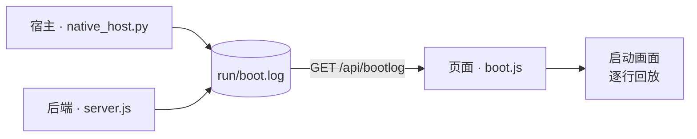

# Ponko-HUD

English version — [README.en.md](README.en.md)

> 全屏无边框的 eDEX-UI 风格 HUD 桌面应用（Windows）。自己动手画的字符网格，没有 Electron 那套重壳。

**Windows** · **零第三方依赖** · **MIT** · 界面语言 `zh-cn` / `en` / `ja`

## 目录

- [特性](#特性)
- [运行](#运行)
- [启动自检（开机刷屏）](#启动自检开机刷屏)
- [结构](#结构)
- [说明](#说明)
- [License](#license)

---

## 特性

- **自绘字符网格** —— Canvas 2D 逐字符渲染整个界面，不是 DOM 拼出来的
- **开机自检刷屏** —— 启动滚一屏内核日志，但**每一行都是真的**
  <details><summary>三段各自记什么（点开）</summary>

  宿主（互斥体 / node 路径与版本 / 后端进程与握手耗时 / WebView2 装载 / 窗口尺寸）、
  后端（node 与平台 / LLM 有没有配 / 素材包与帧文件数 / `python -V` 真探一次 / 系统与磁盘 /
  对话存档数 / 端口监听）、页面（画布与字体度量 / 渲染内核 / 素材包装载 / 恢复对话 /
  各接口真实耗时）—— 三段的真实步骤与真实耗时，时间戳照原样显示，见「启动自检」一节。

  </details>
- **真终端** —— ConPTY 驱动的 PTY，按键裸直通（参照 eDEX-UI / xterm.js 模型），vim / python / htop 等全交互程序都能跑，中文 IME 正常；多标签终端，每个标签一个独立会话
- **Agent 对话** —— 接 OpenAI 兼容接口，流式输出。**框顶右上角显示的就是此刻连着的模型 id**（从后端配置读回来的真值，不写死），没接上时显示 `local · 未接 LLM`
  <details><summary>对话怎么存、怎么删（点开）</summary>

  多标签 = 多个对话，自动存档到 `run/conversations/`，重启原样恢复；输入框里打 `/del chat` +
  `Ctrl+Enter` 会先弹一行确认，回车才真关掉当前对话（连存档，见下）。
  未配置 LLM 时界面内直接弹配置框。

  </details>
- **实时地理地球** —— 真实 IP / DNS 地理位置，字符点阵球面投影 + 自动跑马灯
- **心情角色** —— 方块字符动画角色，心情由 Agent 正文标记 `[[mood:STATE|face:...]]` 自主控制
- **原生窗口** —— pywebview + WebView2，独立任务栏身份、自有图标、单实例
- **零依赖后端** —— 纯 Node 标准库，无任何第三方包

---

## 运行

```bat
start-native.bat        :: 原生窗口（推荐）
```

后端监听 `127.0.0.1:8787`，由启动脚本自动拉起。

启动顺序是"**窗口先接入，功能慢慢起**"：宿主先把窗口建出来（里面是一页占位内容），
后端在后台拉起、真的应答 200 之后窗口才导航到真页面 —— 探端口（Winsock 首次初始化
实测 365ms）、拉起 node、等它自检，这些都不再排在建窗前面。本机实测"双击 → 窗口出现"
**2.7s → 1.5s**（每次启动都会把这一数字记进 `run/boot.log` 的「窗口已显示」那行）。
调试时还想更快：`python native_host.py --fast`（跳过启动刷屏，再省约 2 秒）。

退出：点界面右上角的 `✕ 退出` 按钮，或按 `Ctrl+Shift+Q`（两者都需要**连点/连按两次**确认，防误触）。
命令行退出仍是 `stop.bat`。

---

## 启动自检（开机刷屏）

eDEX-UI 开机时会滚一屏内核日志；这里做的是同一件事，但只放**真日志**——没有任何一行是
为了"像启动画面"而写死的。三段各自在自己真正发生的那一刻记一行，带真实时间戳：



| 来源 | 谁记的 | 记什么 |
| --- | --- | --- |
| `host` | `native_host.py` | 单实例互斥体、`node.exe` 真实路径与 `node -v`、后端 pid 与端口、任务栏身份、pywebview 版本、窗口尺寸、**窗口显示出来花了多久**、端口握手真实耗时 |
| `node` / `llm` / `pack` / `pty` / `conv` / `sys` / `net` | `server/server.js` | Node 与平台版本、LLM 配没配（**绝不回显 Key**）、现场扫出来的素材包/表情/帧文件数与体积、真起一次 `python -V` 探到的解释器、系统与磁盘现状、对话存档数、监听端口、地理查询结果 |
| `ui` | 页面自己 | 画布像素与 dpr、等宽字体量出来的单元格、真实渲染内核（UA）、素材包装载、恢复的对话、各接口真实往返耗时、第 3 帧的整幅重绘耗时 |

宿主与后端把日志追加到**同一个文件** `run/boot.log`（每次启动由宿主截断，只留本次），
前端 `GET /api/bootlog` 取回来在启动画面上逐行回放。回放唯一的"演出成分"是把行与行之间的
**间隔**按比例压进约 1.5s（否则一屏字瞬间闪完）——**每行显示的时间戳是真的，一个字都不动**。

放完之后先停顿约 0.3s 让人看清最后一屏，再**整屏同时淡出**（所有元素共用同一个可见度，
一起溶进主题背景，约 0.34s，不是逐行散场），淡完才进 HUD 的展开动画。

- 想直接看原始记录：`run/boot.log`。该目录不入库，不会被推到 GitHub。
- 文件里存的是**事件 id + 参数**，不是成品句子：
  `2026-10-13 00:40:12.345  host   boot.host.started {"pid":1234,"py":"3.14.4"}`
  句子由页面按**当前语言**渲染（见下面"语言"）。这样宿主/后端不必懂任何语言，
  而启动画面上的每一行都能跟着语言包走 —— 那些行是在页面拿到语言包之前就落盘的。
- 调试：`?boot=0` 跳过启动画面，`?bootpace=N` 改回放预算（毫秒），`?lang=en` 临时切语言。
- **语言**：界面文案（`ui.*`）与启动画面（含宿主/后端那些行、底部进度条）都跟**语言包**走 ——
  语言包里写了就用该语言，没写就回退英文（`en.js` 是 `ui.*` 与 `boot.*` 共同的兜底；
  缺的落英文而不是落中文，免得半英半中）。简中包 `zh-cn.js` 里两段都是全的，所以简中下
  整个界面与启动画面都是中文；想让别的语言也如此，往那个语言包补同名 key 即可。
  **日语包 `ja.js` 只补了 `ui.*`**（`boot.*` 故意留空）→ 日语下界面是日语、启动画面是英文。
- 回归：`node tools/test_boot.mjs`（后端每行都能对着现场复算）、`node tools/test_boot_ui.mjs`（版式、打字与收尾淡出、语言包决定句子）、`node tools/test_i18n.mjs`（语言边界：只有 `ui.*`/`boot.*` 能进字典，服务层与识别层不许 import i18n，宿主/后端发的事件 id 必须两个包里都有，`zh-cn` 与 `ja` 的 `ui.*` 必须是"全的" —— 缺一条那条就落到 `en.js` 上、屏幕上会冒出一个英文词）、`node tools/test_readme.mjs`（两份 README 必须同构）、`python tools/test_boot_host.py`（宿主写的行后端能逐字解析回来）。
- **改了某个行为，就回头把语言包里描述这个行为的文案一起清掉**：切语言从第 13 轮起就是当场生效，
  回执却还写着"下次启动时生效" —— 第 15 轮补了守卫，不许这种过时措辞再出现。

---

## 结构

```
app/src/        前端：grid 字符网格、vt 终端仿真、panels 各面板、boot.js 启动自检画面
app/src/i18n/   语言包：index.js 的 t() 入口 + zh-cn.js（简中，ui.*/boot.* 都是全的）+ en.js（ui.* 与 boot.* 的兜底：任何语言包缺的条目都落这里）+ ja.js（界面日语；启动日志 boot.* 故意留空 → 落英文）
server/         后端：server.js HTTP 服务、bootlog.js 启动记录、pty.js PTY 管理、ptybridge.py Windows ConPTY 桥
characters/     角色动画资源（.ans / .json）
native_host.py  pywebview 原生窗口宿主
run/            运行时产物（对话存档、boot.log、host.log）：已在 .gitignore 中排除，**不进仓库**
```

多标签快捷键只有 `Ctrl+Shift+T`（新建）与 `Ctrl+Tab` / `Ctrl+Shift+Tab`（轮流切换），按**焦点**
分派：焦点在 SHELL 时管终端标签，焦点在 AGENT 时管对话标签。
**关标签 / 删对话都不占键位**（`Ctrl+Shift+W` 已删）：关终端标签就在那个标签里打 `exit`，
删对话就在输入框里打 `/del chat` —— 一句话说得清"关哪个"，比记一个一手滑就生效的键位安全。

不想记键位也行 —— 在对话输入框里打一条**斜杠命令**、`Ctrl+Enter` 发出去：

| 命令 | 作用 |
|---|---|
| `/del chat` | 请求关掉当前对话；先弹一行确认，**回车才真删**（连 `run/conversations/<id>.json` 存档，没有回收站） |

- 打字表达的是"想删哪一个"，不是"现在立刻删"：命令命中后只弹底部那道红条，
  `回车`确认 / `ESC`取消 / 开始打别的字也算取消 / 6 秒不理会自动过期。删的是磁盘上的存档，
  多这一步只花时间、不花判断力 —— 这也是删对话唯一的入口（没有键位）。
- 只认「整条输入恰好是 `/del chat`」，带别的字（`/del chat 吧`）或认不出的命令（`/foo`）
  一律当普通正文交给模型 —— 绝不吞用户的话，命令本身也不会进对话上下文。
- 只剩一个对话时关不掉（面板没有"零个对话"这个状态）→ 改成**换成一个新的空对话**，
  旧内容连同存档一起清掉；确认条上会把"会换成新的空对话"说清楚。
- 没接 LLM 时面板会被配置表单盖住、键盘落在字段上，这时在**字段里**打同一条命令同样生效
  （否则最需要删掉旧对话的状态反而删不了）。

SHELL 面板里另有一组**内置命令**（在终端里直接打，不带斜杠）：

| 命令 | 作用 |
|---|---|
| `lang` | 显示当前 `lang_id`、用法、可输入的语言清单（一个 id 独占一行） |
| `lang <lang_id>` | 切换界面语言，**当场整屏重译**（偏好也记进浏览器，下次开还是它） |
| `ponko-help` | 面板帮助（原生 `help` / `Get-Help` 没被占用） |
| `clear` / `cls` | 清屏 |
| `pty <cmd>` | 开真终端跑任意程序 |
| `exit` | 结束本标签的会话并关掉该标签 |

`lang` 是面板内置的（真 shell 里没有这条命令），所以它会优先于同名原生命令；只认
「整条恰好是 `lang` 或 `lang <一个词>`」，`lang a b` 这种照常发给 shell，不吞你打的东西。

---

## 说明

**底部提示行只报"看不见的事"。** 删了对话、放大/还原了面板、切了标签 —— 这些界面自己
已经在说（标签栏少一个、框撑满内容区、色块挪了位），不会再额外打一行字。留着的只有三类
不看不知道的：

- **按了却没发生**：「最后一个对话不能关」「标签数已达上限」——得说清为什么没反应；
- **屏幕外发生的操作结果**：「已复制 N 字符」「复制失败」——否则不知道成没成；
- **要你再动一下的**：「再点一次「退出」确认」「正在退出…」。

界面文案与代码注释为中文；语言包机制见 `app/src/i18n/`（目前有简中、英文、日语三份）。
`ui.*`（界面）与 `boot.*`（启动日志）都接到了语言包上：**任何语言包缺哪条就落 `en.js`**
（落英文、不落中文，免得半英半中）。日语包 `ja.js` 翻的是**界面文案**，`boot.*` 故意留空
—— 所以日语下界面是日语、启动画面是英文。换语言在 SHELL 里打 `lang`，可输入的语言 id
会当场列出来；`lang <id>` 切过去**当场整屏重译**（连已经刷过去的历史行、底部提示、配置框
一起变，**不用重开 HUD**），偏好也记进浏览器（下次开还是它）。
项目硬编码了本机路径，克隆后请按需修改 `native_host.py` 与 `app/src/main.js` 中的目录。

---

## License

[MIT](LICENSE) © 2026 visitor257

`characters/ds-whale/` 是**开发期的测试占位角色**，由 `tools/make_test_assets.py` 程序绘制（几何图形生成，
不含任何第三方素材），同样适用上述 MIT 授权。它会替换为正式角色形象，请勿依赖。
