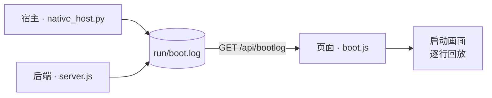

# Ponko-HUD

English version — [README.en.md](README.en.md)

> 全屏无边框的 eDEX-UI 风格 HUD 桌面应用（Windows）。界面由自绘字符网格逐帧渲染，不依赖 Electron 等应用框架。

**Windows** · **前端 / 后端零依赖** · **代码 MIT / 形象保留所有权利** · 界面语言 `zh-cn` / `en` / `ja` / `ru` / `tlh`

## 目录

- [特性](#特性)
- [依赖](#依赖)
- [运行](#运行)
- [启动自检（开机刷屏）](#启动自检开机刷屏)
- [结构](#结构)
- [说明](#说明)
- [License](#license)

---

## 特性

- **自绘字符网格** —— 整个界面由 Canvas 2D 逐字符渲染，而非 DOM 元素拼装
- **开机自检** —— 启动时逐行滚动内核式日志，每一行均为真实事件
  <details><summary>三段日志各自记录什么（展开）</summary>

  宿主（单实例互斥体 / node 路径与版本 / 后端进程与握手耗时 / WebView2 装载 / 窗口尺寸）、
  后端（node 与平台 / 是否已配置 LLM / 素材包与帧文件数 / 一次真实的 `python -V` 探测 /
  系统与磁盘 / 对话存档数 / 端口监听）、页面（画布与字体度量 / 渲染内核 / 素材包装载 /
  对话恢复 / 各接口真实耗时）—— 均为真实步骤与真实耗时，时间戳原样显示，详见「启动自检」一节。

  </details>
- **真实终端** —— 由 ConPTY 驱动的 PTY，按键直通（模型参照 eDEX-UI / xterm.js）；vim / python / htop 等全交互程序均可运行，中文 IME 正常；支持多标签，每个标签为独立会话
- **Agent 对话** —— 接入 OpenAI 兼容接口，流式输出。**LLM 配置每个对话一份**（点「+」新建时，表单预填的是**你按 + 那一刻正看着的那个对话**那份；那个没配过就留空，改哪个都不影响别的对话）；框顶右上角显示**当前对话**实际连接的模型 id（不写死），未接入时显示 `local · 未接 LLM`。输入框里 **Enter 换行、`Ctrl+Enter` 发送**（左右 Ctrl 都认；`Alt+Enter` 同样发送 —— 右 Ctrl 被输入法占着时用它）
  <details><summary>对话的存档与删除（展开）</summary>

  多标签对应多个对话，自动存档至 `run/conversations/`，重启后原样恢复。每个标签的**颜色也一起存**
  （存档里的色号），所以"那个蓝的是我刚才问问题那个"在关掉再开之后仍然成立 —— 不会因为标签顺序
  变成"最后动过的排最后"就重新洗一遍色（2026-10-15 修）。**标签栏里开着的对话一律
  存下来** —— 哪怕它还没配 LLM、一个字都没说过；所以"开两个没配的标签 → 关掉 → 再开"回来还是两个，
  标签数不会自己缩水（存档里存的是空对话、标题也是空的，不写任何界面文案）。在输入框输入
  `/del chat` + `Ctrl+Enter` 会先弹出确认行，回车后才真正关闭当前对话（连同存档）。
  某个对话没配 LLM 时，它显示的**就是配置界面**（这事在点「+」新建、以及冷启动 / 重启之后都一样：
  没接过 LLM 的对话一句话都发不出去，摆个能打字的空聊天框没意义）。点「+」新建对话时，表单里
  **预填的是按 + 那一刻你正看着的那个对话**的地址与 Key（那个对话没配过就留空），改完只影响这个
  对话 —— 想换个模型/换个中转站，就新开一个对话，
  不用改全局、也不用担心把正在用的那个弄坏。这张表单跟着**对话**走：填到一半切到别的对话看看，
  切回来还是刚才那个样子（半句都不会丢）；点「取消」/ ESC 是明确说"这次不用了"—— 新建流程里
  它会连标签一起撤掉，否则只是收起（输入 `/llm` 可随时把它叫回来）。

  </details>
- **形象** —— 配置表单里「形象」一栏决定右侧立绘用哪个素材包：可选**自动**或任一已保存的包
  （`characters/<id>`）。**形象也是每个对话一份** —— 切标签就换人。选「自动」时，保存那一刻会
  把候选清单交给**刚配好的那个模型**，让它自己挑一个（只回 id；挑不出来就如实报错并先用默认包，
  **不影响配置保存**）。模型挑的结果会记进对话（`形象：<id>（<model> 自己挑的）`），下次打开还是它
- **性格** —— 同一张表单里的「性格」一栏（自然 / 傲娇 / 元气 / 毒舌 / 温柔），**同样每个对话一份**、
  随存档走。它是**写给模型的人设**，决定它情绪表达的路子：「自然」不额外加人设（提示词本身已经把它
  写成一个有脾气的角色），其余四种各给一套口吻与反应倾向
- **实时地理地球** —— 由真实 IP / DNS 定位，字符点阵球面投影，自动跑马灯
- **心情角色** —— 立绘可选**点阵化高清贴图**（`src/*.png`，绕开字符网格，再采样成方块点阵）或
  **方块字符画**（`frames/*.json`，素材包没有高清图时的回退），素材包自动二选一；面板左上角是形象名，
  换形象时**旧立绘不提前退场**、等新的备齐才一次换过去（不闪空白）；心情由 Agent 正文中的
  `[[mood:STATE|face:...]]` 标记自主控制（控制语句本身不显示在对话里）。**情绪有记忆和惯性**：每轮请求
  都会把「你此刻的心情」交给模型（上一刻是什么、心里那句话、持续了多久），所以它不是在每轮重新查表，
  而是接着上一刻的情绪往下走 —— 被惹到了不会下一轮就若无其事，被哄好了才慢慢缓过来。
  **心情是每个对话一份的**（2026-10-17）：新开一个对话从待机开始，不会把上一段对话的火气带过去，
  标签之间也互不影响 —— 后台对话的输出不会改前台的脸色，每段对话的模型拿到的也是**它自己**的
  「此刻心情」。**关掉再开，画面跟退出前一样**：当前心情（配色浓淡 + 立绘表情 + Agent 那句话 + 来源）
  跟着对话存档走（`run/conversations/<id>.json` 的 `mood` 字段），下次启动各自还回来
  —— 所以隔一阵子再开也还是那个心情（2026-10-15 修）。**一个 state 都不折**：包括 `'working'`
  （旧名 `stream`；提示词里"干得起劲"发出来就是它）也原样还回来 —— 退出时是什么，重开就是什么
  （2026-10-18 修）。七个 STATE 是 `idle / think / working / happy / sleepy / angry / error`：
  `working` 指"正在逐字输出、手上正忙得起劲"，`happy` 指"心里亮起来了"（被夸、被逗到、事情成了）——
  两者能同时成立，模型按它此刻那句心里话挑一个（2026-10-18 加 `happy` 时把这两档分开了）。
  **心情只由 agent 改**（2026-10-17）：没有"没人说话两分钟就自动变瞌睡"这种兜底，也不会因为
  声明"到期"自己退回待机 —— 停多久就是多久，直到 agent 下一次开口。程序只在三种情况下动它：
  新对话从待机起步、开机把 agent 自己声明过的那份还回来、调试旁路 `?mood=`
  **模型整轮漏了标记会被补问**（2026-10-18）：它有时嘴上说"就定在这一档"，正文里却一条
  标记都没写 —— 那一轮界面就一步不动，用户看到的就是"心情设错了"。所以流结束、且一条声明
  都没收到时，后端拿它刚说完的正文再问一次，只让它输出一行标记（还是模型自己判断，不是本地猜）；
  补不出来就保持原样，绝不硬塞一个 state。每轮**实际声明了什么**、是正文里的还是补问来的，
  记在 `run/mood.log`，出问题能回看。
- **原生窗口** —— pywebview + WebView2，独立任务栏身份、自有图标、单实例
- **零依赖后端** —— 纯 Node 标准库实现，无任何第三方包

---

## 依赖

- **前端（`app/`）** —— 无构建步骤、无 npm 包、无 CDN 请求，仅使用浏览器原生 API。
- **后端（`server/`）** —— 仅依赖 Node 标准库。
- **Python 宿主层** —— 需要以下两个第三方包，均已在 `requirements.txt` 中声明：
  - `pywebview` —— 原生窗口外壳（WebView2）；
  - `pywinpty` —— ConPTY 交互式终端桥。
- **开发脚本（`tools/`）** —— 生成素材时需要 `Pillow`，运行应用本身不需要。

安装运行时依赖：

```bat
pip install -r requirements.txt
```

---

## 运行

```bat
start-native.bat        :: 原生窗口（推荐）
```

后端监听 `127.0.0.1:8787`，由启动脚本自动拉起。

启动顺序采用「**窗口先接入，功能逐步就绪**」：宿主先创建窗口（内为占位页），后端在后台拉起，
待其真正应答 200 后窗口才导航至真实页面 —— 端口探测（Winsock 首次初始化，实测 365ms）、
拉起 node、等待自检，均不再阻塞建窗。本机实测「双击 → 窗口出现」由 **2.7s 降至 1.5s**
（每次启动都会将该数字写入 `run/boot.log` 的「窗口已显示」行）。调试时可进一步加速：
`python native_host.py --fast`（跳过启动刷屏，再省约 2 秒）。

退出：点击界面右上角的 `✕ 退出` 按钮，或按 `Ctrl+Shift+Q`（两者均需**连点 / 连按两次**确认，防误触）。
命令行退出仍为 `stop.bat`。

---

## 启动自检（开机刷屏）

eDEX-UI 开机时会滚动一屏内核日志；本项目做的是同一件事，但只放**真实日志** —— 没有任何一行
是为了「像启动画面」而写死的。三部分各自在真正发生的那一刻记录一行，带真实时间戳：



| 来源 | 记录者 | 记录内容 |
| --- | --- | --- |
| `host` | `native_host.py` | 单实例互斥体、`node.exe` 真实路径与 `node -v`、后端 pid 与端口、任务栏身份、pywebview 版本、窗口尺寸、**窗口显示耗时**、端口握手真实耗时 |
| `node` / `llm` / `pack` / `pty` / `conv` / `sys` / `net` | `server/server.js` | Node 与平台版本、**扫一遍对话存档**得知有没有对话接了 LLM（只报主机/模型/协议，**绝不回显 Key**）、现场扫描得到的素材包 / 表情 / 帧文件数与体积、实际运行一次 `python -V` 探测到的解释器、系统与磁盘现状、对话存档数、监听端口、地理查询结果 |
| `ui` | 页面自身 | 画布像素与 dpr、等宽字体实测出的单元格、真实渲染内核（UA）、素材包装载、恢复的对话、各接口真实往返耗时、第 3 帧的整幅重绘耗时 |

宿主与后端将日志追加到**同一个文件** `run/boot.log`（每次启动由宿主截断，仅保留本次），
前端通过 `GET /api/bootlog` 取回，在启动画面上逐行回放。回放唯一的「演出成分」是将行与行之间的
**间隔**按比例压缩进约 1.5s（否则一屏文字会瞬间闪过）—— **每行显示的时间戳都是真实的，不做任何改动**。

放完后先停顿约 0.3s 以便看清最后一屏，再**整屏同步淡出**（所有元素共用同一可见度，一起溶入
主题背景，约 0.34s，非逐行退出），淡出结束后才进入 HUD 的展开动画。

- 原始记录：`run/boot.log`。该目录不入库，不会被推送到 GitHub。
- 文件中存储的是**事件 id + 参数**，而非成句文本：
  `2026-10-13 00:40:12.345  host   boot.host.started {"pid":1234,"py":"3.14.4"}`
  文本由页面按**当前语言**渲染（见下「语言」）。因此宿主与后端无需了解任何语言，而启动画面上的
  每一行都能跟随语言包 —— 这些行在页面取得语言包之前就已落盘。
- 调试：`?boot=0` 跳过启动画面，`?bootpace=N` 调整回放预算（毫秒），`?lang=en` 临时切换语言，
  `?art=photo` 把立绘换回"直接贴原图"（默认为点阵化）。
- **语言**：界面文案（`ui.*`）与启动画面（含宿主 / 后端各行、底部进度条）均跟随**语言包** ——
  语言包中有则使用该语言，没有则回退英文（`en.js` 是 `ui.*` 与 `boot.*` 共同的兜底；缺项回退
  英文而非中文，以免中英混杂）。简中包 `zh-cn.js` 两段均为全量，故简中下界面与启动画面均为中文；
  其他语言补上同名 key 即可获得同样效果。**日语包 `ja.js` 仅补 `ui.*`**（`boot.*` 故意留空）
  → 日语下界面为日语、启动画面为英文。**俄语包 `ru.js` 两段都是全量**（含宿主 / 后端那几十行）
  → 俄语下界面与启动画面都是俄语。**克林贡语包 `tlh.js` 也是全量，而且正文是克林贡文字形
  （pIqaD，私用区 U+F8D0 起），不是罗马化** —— 这一段私用区 Windows 自带字体一个字形都没有，
  所以字体随包分发（`app/assets/fonts/pIqaD-qolqoS.ttf`，SIL OFL，未改动），
  `style.css` 的 `@font-face` + `grid.js` 的字体栈负责把它接到画布上。改文案用
  `node tools/piqad.mjs --roman/--piqad` 转进转出，别手敲私用区码点。
- 回归：`node tools/test_boot.mjs`（后端每行均可对着现场复算）、`node tools/test_boot_ui.mjs`（版式、打字与收尾淡出、语言包决定句子）、`node tools/test_i18n.mjs`（语言边界：仅 `ui.*` / `boot.*` 可进字典，服务层与识别层不得 import i18n，宿主 / 后端发出的事件 id 必须在两个包中都存在，`zh-cn` 与 `ja` 的 `ui.*` 必须为「全量」—— 缺一条该条就落到 `en.js`，屏幕上会冒出一个英文词）、`node tools/test_readme.mjs`（两份 README 必须同构）、`python tools/test_boot_host.py`（宿主写出的行可被后端逐字解析回来）。
- **行为变更时，应同步清理语言包中描述该行为的文案**：语言切换自第 13 轮起即为即时生效，而回执仍写着「下次启动时生效」—— 第 15 轮加入守卫，禁止此类过时措辞再次出现。

---

## 结构

```
app/src/        前端：grid 字符网格、dots 立绘点阵化、vt 终端仿真、panels 各面板、boot.js 启动自检画面
app/src/i18n/   语言包：index.js 的 t() 入口 + zh-cn.js（简中，ui.*/boot.* 均为全量）+ en.js（ui.* 与 boot.* 的兜底：任何语言包缺的条目都落这里）+ ja.js（界面日语；启动日志 boot.* 故意留空 → 落英文）+ ru.js（俄语，ui.* 与 boot.* 均为全量）+ tlh.js（克林贡语，ui.* 与 boot.* 均为全量，正文是 pIqaD 字形）
  + assets/fonts/pIqaD-qolqoS.ttf（克林贡文字体，SIL OFL，随包分发）
server/         后端：server.js HTTP 服务、bootlog.js 启动记录、pty.js PTY 管理、ptybridge.py Windows ConPTY 桥
characters/     角色素材（src/*.png 高清立绘 + frames/*.ans|json 字符帧）；美术素材保留所有权利，不在 MIT 内（characters/LICENSE）
tools/assets/   应用图标（.ico + 各尺寸 png）；同为美术素材，保留所有权利（tools/assets/LICENSE）
native_host.py  pywebview 原生窗口宿主
run/            运行时产物（对话存档、ui-state.json 界面状态、boot.log、host.log）：已在 .gitignore 中排除，**不进仓库**
```

多标签快捷键仅 `Ctrl+Shift+T`（新建）与 `Ctrl+Tab` / `Ctrl+Shift+Tab`（轮换），按**焦点**分派：
焦点在 SHELL 时操作终端标签，焦点在 AGENT 时操作对话标签。**关闭标签 / 删除对话均不占键位**
（`Ctrl+Shift+W` 已删除）：关闭终端标签在该标签内输入 `exit`，删除对话在输入框输入 `/del chat` ——
明确指定「关哪一个」，比记忆一个易误触的键位更安全。

若不记键位，可在对话输入框中输入一条**斜杠命令**，以 `Ctrl+Enter` 发出：

| 命令 | 作用 |
|---|---|
| `/del chat` | 请求关闭当前对话；先弹出确认行，**回车后才真正删除**（连同 `run/conversations/<id>.json` 存档，无回收站） |

- 输入表达的是「想删哪一个」，而非「立即删除」：命令命中后仅弹出底部红条，`回车`确认 /
  `ESC`取消 / 继续输入其他内容亦视为取消 / 6 秒无操作自动过期。删除的是磁盘上的存档；
  这一步只增加时间成本，不增加判断成本 —— 这也是删除对话的唯一入口（无键位）。
- 仅识别「整条输入恰好为 `/del chat`」；带有其他内容（如 `/del chat 吧`）或无法识别的命令
  （`/foo`）一律作为普通正文交给模型 —— 不会吞掉用户输入，命令本身也不进入对话上下文。
- 仅剩一个对话时无法关闭（面板不存在「零个对话」状态）→ 改为**替换为一个新的空对话**，
  旧内容连同存档一并清除；确认条中会说明这一点。
- 未接入 LLM 时面板被配置表单覆盖、键盘落在字段上，此时在**字段中**输入同一命令同样生效
  （否则最需要删除旧对话的状态反而无法删除）。

SHELL 面板另有一组**内置命令**（在终端中直接输入，不带斜杠）：

| 命令 | 作用 |
|---|---|
| `lang` | 显示当前 `lang_id`、用法、可输入的语言清单（每个 id 独占一行） |
| `lang <lang_id>` | 切换界面语言，**当场整屏重译**（偏好亦记入浏览器，下次启动沿用） |
| `ponko-help` | 面板帮助（原生 `help` / `Get-Help` 未被占用） |
| `clear` / `cls` | 清屏 |
| `pty <cmd>` | 打开真实终端运行任意程序 |
| `exit` | 结束本标签会话并关闭该标签 |

`lang` 为面板内置命令（真实 shell 中无此命令），因此优先于同名原生命令；仅识别「整条恰好为
`lang` 或 `lang <一个词>`」，`lang a b` 照常发送给 shell，不会吞掉输入。

**Tab 补全**（管道模式）：输入框里**有内容**时 `Tab` 是补全 —— 路径按这个标签**真实的工作目录**
补（目录补完带 `\`，接着按 `Tab` 继续往里进），行首或 `|` 之后补命令名（来自 `PATH` 里的可执行
文件）；多个候选时先补到公共前缀，其余列在屏幕上，再打一两个字母就唯一了。输入框**为空**时
`Tab` 仍是老行为（SHELL ⇄ AGENT 切焦点）。真终端里 `Tab` 是原样发给程序的：`pty pwsh` /
`pty python` 的补全由那个程序自己做（权限比这里大得多），本项目不插手。

---

## 说明

**底部提示行只报告界面上无法直接看到的事件。** 删除对话、放大 / 还原面板、切换标签等操作，
界面本身已有反馈（标签栏少一项、面板撑满内容区、色块位置变化），不再额外输出文字。
保留下来的仅三类：

- **已操作但无响应**：「最后一个对话不能关」「标签数已达上限」—— 需说明未生效的原因；
- **操作在屏幕外完成**：「已复制 N 字符」「复制失败」—— 否则无法确认结果；
- **需再次确认的操作**：「再点一次「退出」确认关闭 Ponko-HUD」「正在退出 Ponko-HUD…」。

界面文案与代码注释为中文；语言包机制见 `app/src/i18n/`（目前有简中、英文、日语、俄语、克林贡语五份）。
`ui.*`（界面）与 `boot.*`（启动日志）均已接入语言包：**任何语言包缺失的条目均回退至 `en.js`**
（回退英文而非中文，以免中英混杂）。日语包 `ja.js` 翻译的是**界面文案**，`boot.*` 故意留空 ——
故日语下界面为日语、启动画面为英文；俄语包 `ru.js` 两段全量，故俄语下两者都是俄语；克林贡语包 `tlh.js`
同样是全量，但正文是**克林贡文字形**（pIqaD）而不是拉丁转写，字体由 `app/assets/fonts/` 自带（SIL OFL）。
切换语言在 SHELL 中输入 `lang`，可输入的语言 id 会当场列出；
`lang <id>` 切换后**当场整屏重译**（包括已滚过的历史行、底部提示、配置框，**无需重开 HUD**），
偏好亦记入浏览器（下次启动沿用）。项目硬编码了本机路径，克隆后请按需修改 `native_host.py` 与
`app/src/main.js` 中的目录。

---

## License

[代码 MIT](LICENSE) © 2026 visitor257

**代码**（`app/`、`server/`、`tools/` 里的脚本、`native_host.py` 等）按 MIT 授权。

**美术资源不在其内，保留所有权利**：`characters/`（立绘 `src/*.png`、字符帧 `frames/*`、`pack.json`）
见 [characters/LICENSE](characters/LICENSE)，`tools/assets/`（应用图标）见
[tools/assets/LICENSE](tools/assets/LICENSE)。两处条款相同，简言之：

- **可以**：随本项目运行、留在 fork / 克隆里、展示应用截图或录像；在**非商业**的介绍 / 评测 / 引用里
  贴出**未经修改**的素材并注明出处
- **不可以**：商用；修改、改色、重绘或做成衍生作品（头像、封面、周边、其他角色）；单独摘出来再分发

商用或别的用途，先在仓库开 issue 问一声。随包的克林贡字体 `app/assets/fonts/` 按 SIL OFL 分发
（许可证文本跟字体放在一起）。

「Ponko」是项目名，名称相关权利归作者所有（未申请商标）。

`characters/ponko/` 是**正式角色形象**：`src/` 里 7 张图 = 七个 state 各一张。
⚠ 素材**标签**（文件名）跟 state 名不完全一样：`working` 这一档的图叫 `streaming`
（改标签要连带重命名 `frames/*.ans|*.json`，而且旧存档里的 `face:"streaming"` 会失配 ——
所以名字一直没动），其余六档同名。
`frames/` 是 `tools/charpack.py` 转出来的方块字符帧（七张共用同一取景，换表情时人物不会跳）。
`happy`（高兴）原本是 working 之下额外的一张脸，2026-10-18 升成独立的一档 —— 因为它要的不只是换张图，
还要自己那套配色和心情条位置；两张脸以外的区别见上面"七个 STATE"那段。
`angry`（生气）与 `error`（出错）是一对方向相反的坏心情 —— 前者是**朝外**的火气（上火、不服），
后者是**往心里去**的低落（委屈、受挫）；两条配色也刻意分开（火橙红 vs 偏粉的冷红），一眼能认出是哪种。

立绘有**两条路径**，角色面板按素材包自动选（界面上不再标注用了哪条）：

- **高清贴图 · 点阵化**：包里有 `src/<标签>.png` 就先按 contain 光栅化到立绘区尺寸，
  再**采样成方块点阵**贴上去（`app/src/dots.js`），**绕开字符网格**。每 2×2 像素取一块，点边长随该块的
  覆盖率变（实心块铺满整格、轮廓块缩成小方点 —— 印刷半调那种过渡），颜色取该块按 alpha 加权的平均色。
  采样与画点只做一次、结果缓存成离屏画布，之后每帧只是贴一张现成的位图，和直接贴原图同价。
  同一块地方走字符格只有 28×19 = 532 个色块，贴图则是 231×342 个真实像素。
  加 `?art=photo` 启动可换回**直接贴原图**，方便对照。
- **方块字符**：包内没有 `src/` 图、或图加载失败时，回退到 `frames/*.json` 逐格画 `▀`。

**心情的名字归素材包所有**（2026-10-17）。一个心情在界面上叫什么，写在它自己包的
`frames/pack.json` 里，**不在语言包里** —— 名字属于这个角色，跟素材一起分发：换一个角色包
就是另一套叫法，不用动任何语言文件。

```json
"moods": {
  "idle": { "frames": ["idle.ans"], "fps": 0, "loop": false,
            "label": { "en": "idle", "zh-cn": "待机", "ja": "待機" } }
}
```

- **`en` 必填**，其余语言选填。玩家选的语言没翻 → 显示英文；连英文都没写 → 直接显示标签本身
  （宁可把 id 亮出来，也不拿另一种语言顶上）。
- 面板顶上那行心情名、启动画面那行「此刻 …」都用它；`tools/charpack.py --emit-pack` 生成新包时
  会给出 `{"en": <标签>}` 作为默认值，中文/日文自己补。
- 自带的 `ponko` 包**故意不写 `ja`**（用户 2026-10-17：「日文不需要翻译，我要用日文来测试默认显示」）——
  选日本語时心情名就落英文，正好当回退链的活测试。要日文名就往 `label` 里加一条，不用改代码。
- `i18n` 里**没有** `ui.mood.<state>` / `ui.theme.<state>` 这类词条，别再加回去 ——
  两边都有就出现两处真相（换了角色包却没换语言时，没人说得清该听谁的）。

**心情区那两行**：上一行是**名字**（角色包 `label`，跟着语言翻），下一行是
`<角色名> · <心情 id>`（如 `ponko · angry`）。角色名取素材包的 `name`（没写就用 `id`，**不转大写** ——
左上角标题已经是大写装饰）；id 是协议里的原值、永远不翻，排查问题看它；角色名太长（放不下）
就只报 id。这一行**不写来源**（AGENT / 本地 / 手动）—— 谁声明的是调试信息，不上屏。

**手动覆盖是调试功能，界面上不留痕迹**（`app/src/panels/char.js` + `app/src/main.js`）：
入口那排可点的心情标签不画（`SHOW_MOOD_CHIPS = false`）、框底那句「手动覆盖（调试）」不写
（`MUTE_NOTES`）、触发键 `Ctrl+M` 默认关（`MOOD_DEBUG_KEY = false` —— 终端里 `^M` 就是回车，
很容易误触，而痕迹都藏了之后误触就成了"没来由地自己变脸"）。调试时改这几个开关就能看回来。
`?mood=think` 保留：得手改 URL 才用得上，误触不到。

**它还只活在这一趟运行里 —— 不存档、开机不还原。** 心情快照里的 `source` 遇到 `manual`
会折成 `auto`（`mood.js` 的 `snapshot()`），`restore()` 也不认这个来源、锁一律从"没锁"开始
（画面 `state`/`face`/配色照旧还回来，那才是"关掉再开一样"要的部分）。不这样会有个很难查的现象：
`?mood=` 或 `Ctrl+M` 只要用过一次，就进档、之后每次开机都重新锁死一颗调试心情，
面板上一直挂着「手动 · 生气」，看着像 HUD 在自己控制心情（用户 2026-10-17 报的）。

**换形象（切对话）时旧立绘不会提前退场。** 面板里存着"这一刻屏幕上是谁"的快照，
只有新形象**完全备齐**（图已解码 + 点阵已采样）才一次性换过去 —— 因此不会出现
「旧形象消失 → 空白等加载 → 新形象出现」那种闪一下。等待期间新形象的图与点阵在帧外备好
（`preloadArt()` 铺开包内所有立绘、`grid.warmImg()` 提前采样），真正切换的那一帧只剩一次 `drawImage`。

> 一开始只有第二条路。写实立绘缩到 28 列必然糊，于是试过用 `tools/make_ponko_geo.py` 程序化画
> 大色块几何图。它验证了"糊"的根因是**字符网格的分辨率下限**，而不是画法 —— 所以最终的解法是让
> 立绘绕开网格。几何版留在 `characters/_archive/ponko-geo/`，程序不再加载它。

`characters/ponko/src` 由 `tools/_matte_pack.py` 从角色原画生成（连通域抠背景 + 去右下角水印 +
取景到腰），不含任何第三方素材。授权**不随代码走**：代码是 MIT，形象保留所有权利
（[characters/LICENSE](characters/LICENSE)）。

`characters/_archive/` 只留**不再加载**的历史形象（几何版 `ponko-geo`、早期的 `ponko-ai`）——
目录扫描只走 `characters/` 下一层，不会往里钻。开发期那个测试占位角色（`ds-whale`）已经删掉；
要再验一遍素材管线就跑 `tools/make_test_assets.py`，它把五张测试立绘画到系统临时目录，不落进仓库。

（`characters/` 下**每个**带 `frames/pack.json` 的包都会进「形象」候选，由每个对话自己挑。）
